<p align="center">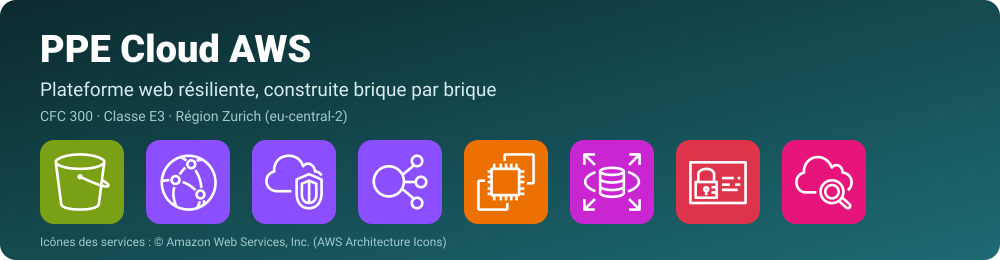</p>

# PPE Cloud AWS — Plateforme web résiliente, construite brique par brique


**Cours de référence :** Cloud AWS — Intégration de services réseau multiplateformes (CFC 300)
**Classe :** E3
**Durée :** 5 jours, 5 briques (semaine PPE qui suit le cours du 16 au 20 novembre 2026)
**Niveau :** Débutant → Avancé (la difficulté monte de brique en brique)

> **Statut : projet validé par le formateur.**
> Les fiches officielles (`03-cloud-aws/`) demandent de choisir **un** projet sur 5. Ce document
> décrit un projet « fil rouge » qui reprend les 5 projets l'un après l'autre, sous forme de
> 5 briques. Les premières, plus simples, sont regroupées pour garder du temps aux dernières.

## Avancement

| | Brique | État | Résumé |
|---|---|---|---|
|  | 0, préparation | ✅ **terminée** | outils installés, connexion, budget, utilisateur IAM limité avec MFA |
|   | 1, S3 + CloudFront | ✅ **en ligne, testée** | site en HTTPS, bucket privé, accès direct refusé |
|  | 2, VPC | ✅ **faite, testée** | 6 sous-réseaux sur 2 zones, isolation prouvée ; NAT et instances supprimés |
|   | 3, EC2 + ALB | ⏳ à faire | |
|  | 4, RDS | 🚧 **application locale testée** | RDS à créer ; essai avec une vraie base PostgreSQL à faire (Docker arrêté sur le poste) |
|   | 5, résilience, IAM, supervision, coûts | ⏳ à faire | |

Environnement : région **Zurich (`eu-central-2`)**, compte AWS personnel en plan gratuit (100 USD de
crédits jusqu'au 10 mai 2027), budget d'alerte de 10 USD par mois.

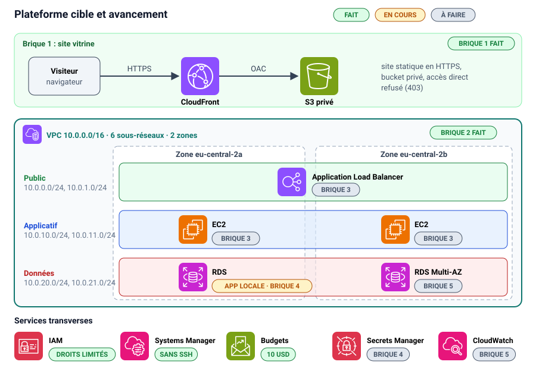

## Services utilisés

| | Service | Rôle dans le projet | Brique |
|---|---|---|---|
|  | **Amazon S3** | stocke le site statique, bucket privé | 1 |
|  | **Amazon CloudFront** | distribue le site en HTTPS, accès au bucket par OAC | 1 |
|  | **Amazon VPC** | réseau isolé : 6 sous-réseaux, routage, NAT | 2 |
|  | **Amazon EC2** | serveurs de test, puis serveurs de l'application | 2, 3 |
|  | **Elastic Load Balancing** | répartit le trafic entre les serveurs | 3 |
|  | **EC2 Auto Scaling** | maintient 2 serveurs répartis sur 2 zones | 5 |
|  | **Amazon RDS** | base PostgreSQL managée, en sous-réseau privé | 4, 5 |
|  | **AWS IAM** | utilisateur à droits limités, rôles au moindre privilège | 0, 5 |
|  | **AWS Systems Manager** | accès aux serveurs sans ouvrir le port 22 | 2 |
|  | **AWS Secrets Manager** | mot de passe de la base, jamais dans le code | 4 |
|  | **Amazon CloudWatch** | alarmes et tableau de bord | 5 |
|  | **AWS Budgets** | alerte à 80 % et 100 % de 10 USD | 0 |
|  | **AWS Cost Explorer** | relevé des coûts en fin de semaine | 5 |

Les services des briques 3, 4 (RDS, Secrets Manager) et 5 sont prévus, pas encore mis en place. Les
icônes des services sont des fichiers officiels d'AWS, repris sans modification (voir
[`assets/aws-icons/NOTICE.md`](assets/aws-icons/NOTICE.md)).

## Rapport de réalisation

Chaque brique a son détail (commandes, tests, problèmes) dans son dossier ; tout l'essentiel et
toutes les captures sont repris ici. Les captures du terminal ont été prises dans un écran virtuel
isolé ; celles de la console AWS sont recadrées pour masquer l'identifiant du compte.

###   Brique 0 — Préparation du poste et du compte

Détail : [`brique-0-preparation/`](brique-0-preparation/README.md)

**Outils.** AWS CLI 2.39.7 et plugin Session Manager 1.2.896.0, installés dans le dossier personnel
(`~/.local/bin`), sans droits administrateur. Avant connexion, aucun identifiant n'est configuré.

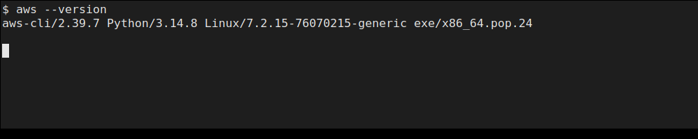

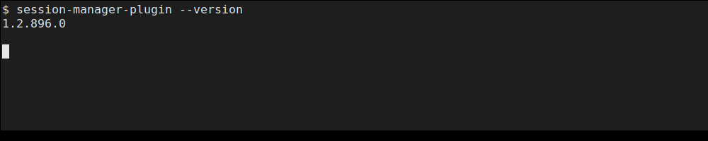

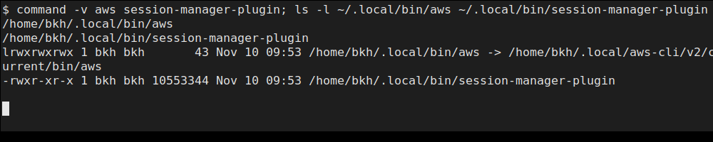

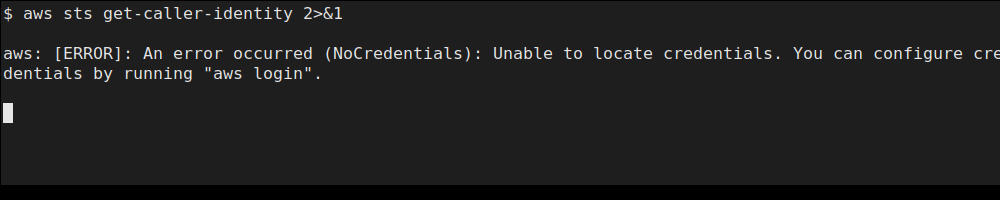

**Connexion et région.** `aws login` ouvre la page de connexion AWS : le mot de passe est saisi par
l'étudiant dans le navigateur, jamais dans le terminal ni dans le dépôt. La région choisie est
`eu-central-2` (Zurich) : elle est active et offre 3 zones de disponibilité.

**Plan gratuit.** Le compte est en plan `FREE`, actif, avec 100 USD de crédits restants jusqu'au
10 mai 2027. Les crédits sont consommés par l'usage : NAT Gateway, Application Load Balancer et RDS
sont facturés à l'heure, d'où le budget d'alerte et le nettoyage quotidien.

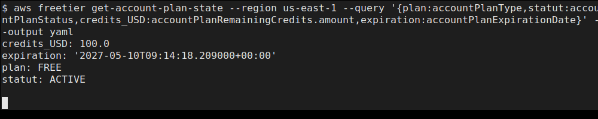

**Budget d'alerte (« jour 0 »).** Budget mensuel de 10 USD, sans déduire les crédits (pour suivre la
consommation réelle), avec deux alertes par e-mail à 80 % et 100 % de la dépense réelle.

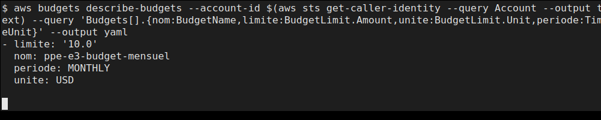

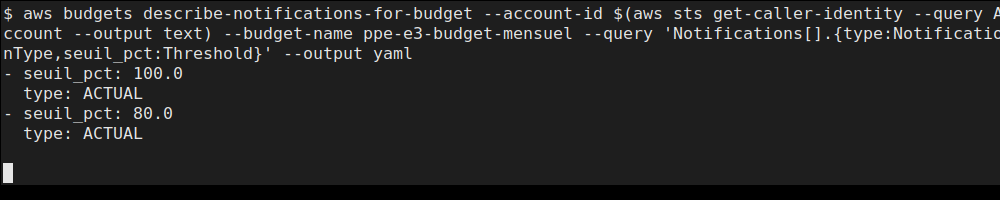

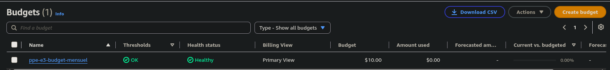

**Utilisateur IAM à droits limités.** Le compte racine n'est pas utilisé au quotidien.

| Élément | Valeur |
|---|---|
| Groupe | `ppe-e3-users` |
| Utilisateur | `ppe-e3-etudiant`, étiquette `Projet=ppe-e3`, MFA par passkey |
| `PowerUserAccess` | tous les services AWS, sauf la gestion IAM |
| `IAMUserChangePassword` | changer son propre mot de passe |
| `ppe-e3-iam-scoped` | gestion IAM limitée aux rôles, politiques et profils `ppe-e3-*`, `iam:PassRole` limité à ces rôles, gestion de son propre MFA, interdiction d'attacher `AdministratorAccess` (fichier [`iam/ppe-e3-iam-scoped.json`](brique-0-preparation/iam/ppe-e3-iam-scoped.json)) |

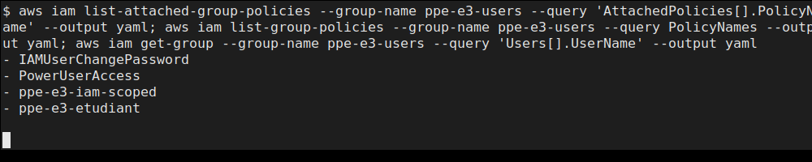

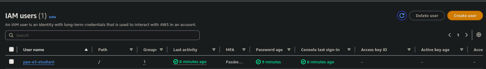

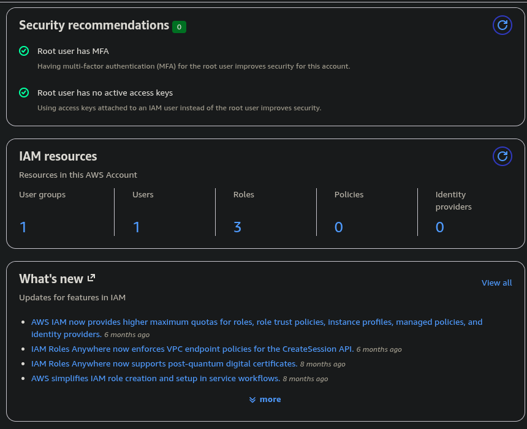

**Preuve des droits limités.** Avec cet utilisateur : créer un utilisateur IAM ou un rôle sans le
préfixe `ppe-e3-` est refusé (`AccessDenied`) ; créer puis supprimer un rôle `ppe-e3-test` fonctionne ;
la lecture du budget et de la distribution CloudFront reste possible.

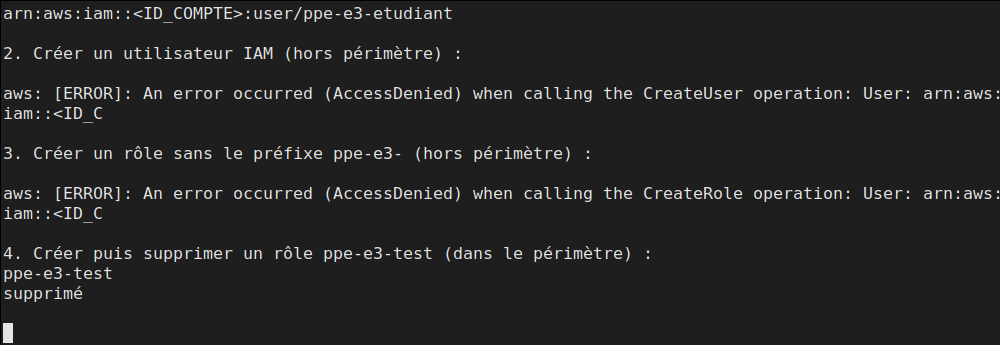

###   Brique 1 — Site vitrine sur S3 et CloudFront (projet 1)

Détail : [`brique-1-s3-cloudfront/`](brique-1-s3-cloudfront/README.md)

Le site de l'association « Horizon » (4 pages HTML et une feuille de style, dans
[`site/`](brique-1-s3-cloudfront/site/)) est servi en **HTTPS** par CloudFront. Le bucket S3 est
**privé** : seule la distribution CloudFront peut lire ses fichiers.

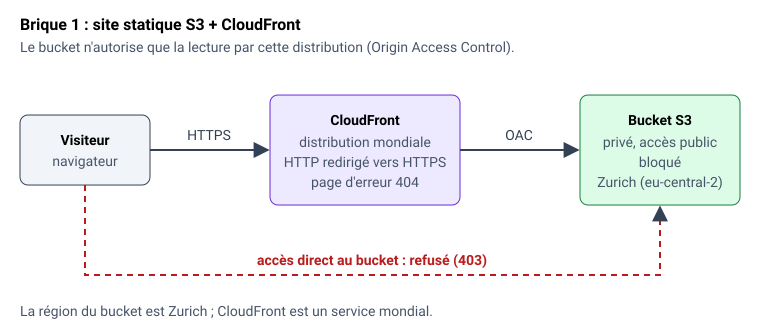

| Élément | Choix |
|---|---|
| Bucket S3 | Zurich, accès public bloqué, chiffrement SSE-S3, étiquette `Projet=ppe-e3` |
| Accès du CDN au bucket | **Origin Access Control (OAC)**, signature SigV4 ; politique du bucket limitée à cette distribution |
| CloudFront | HTTP redirigé vers HTTPS, objet racine `index.html`, compression, HTTP/2 et HTTP/3, `PriceClass_100` |
| Pages introuvables | les erreurs 403 et 404 de l'origine renvoient `/error.html` avec le code 404 |
| Certificat | certificat par défaut `*.cloudfront.net` (pas de domaine personnalisé) |

*Écart avec la fiche officielle :* l'« hébergement de site web statique » du bucket n'est pas activé,
car il impose un bucket public et ne sert qu'en HTTP. Le bucket privé avec OAC répond mieux à
l'objectif de la fiche (« sécuriser l'accès au bucket : accès public contrôlé, HTTPS »). Les fichiers
de configuration (valeurs factices) sont dans [`config/`](brique-1-s3-cloudfront/config/).

| # | Test | Attendu | Résultat |
|---|---|---|---|
| 1 | page d'accueil en HTTPS | 200 | **200** |
| 2 | page des événements en HTTPS | 200 | **200** |
| 3 | `http://…cloudfront.net/` | redirection vers HTTPS | **301** |
| 4 | page inexistante | page d'erreur personnalisée, code 404 | **404** |
| 5 | accès direct au bucket | refusé | **403** |
| 6 | statut de la politique du bucket | non public | `IsPublic: False` |
| 7 | en-têtes de la réponse | passage par CloudFront | `x-cache: Hit from cloudfront` |

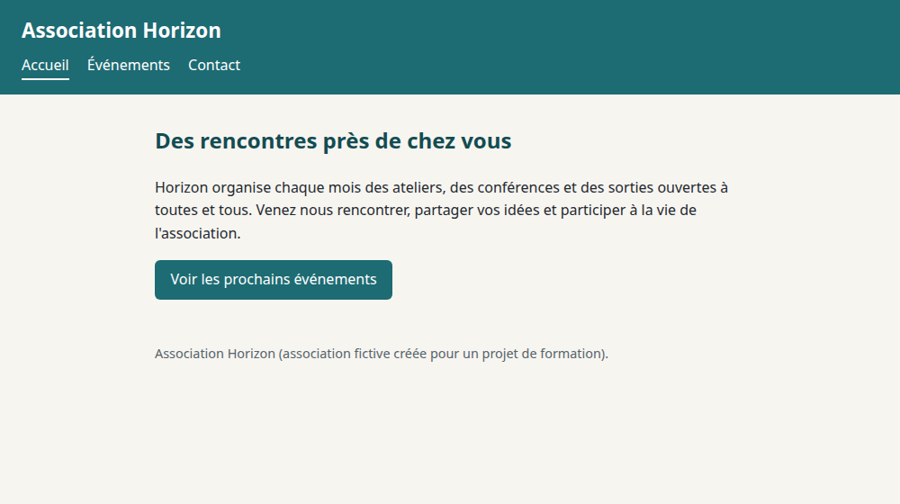

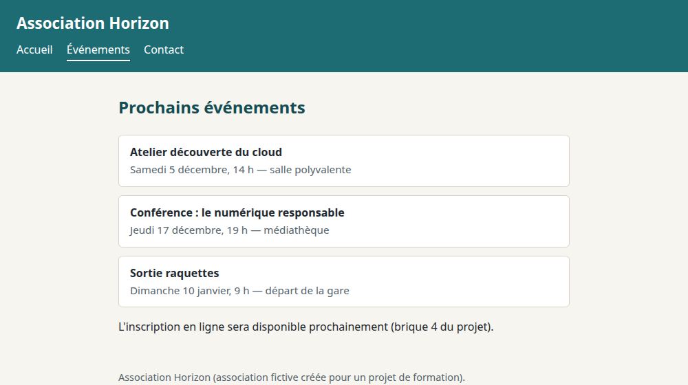

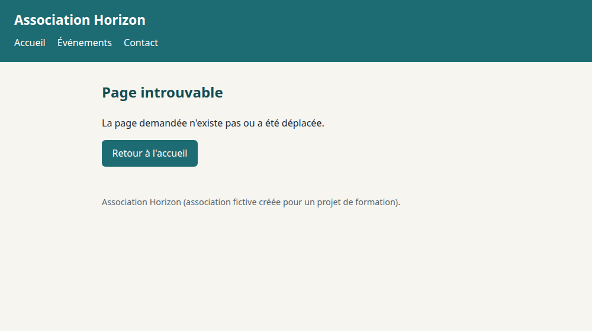

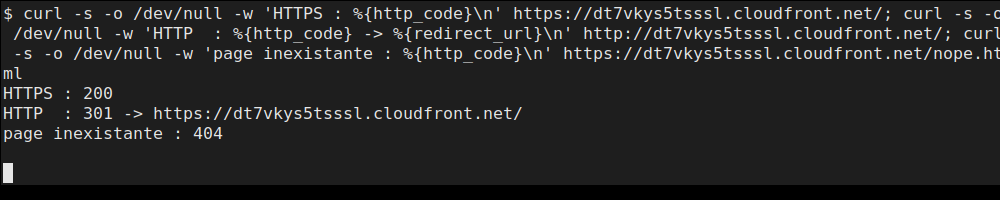

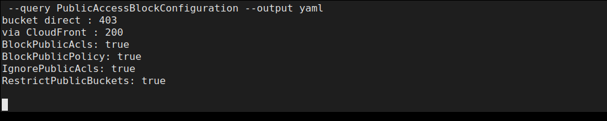

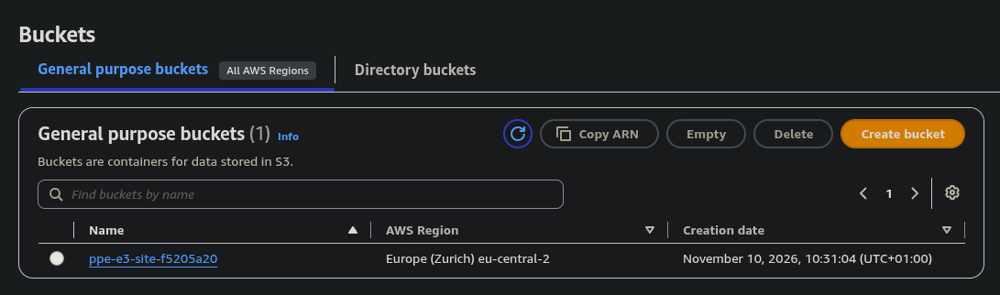

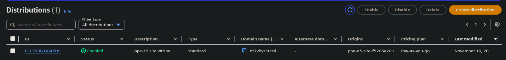

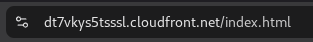

###   Brique 2 — VPC à 2 zones, public et privé (projet 2)

Détail : [`brique-2-vpc/`](brique-2-vpc/README.md) (scripts dans [`scripts/`](brique-2-vpc/scripts/))

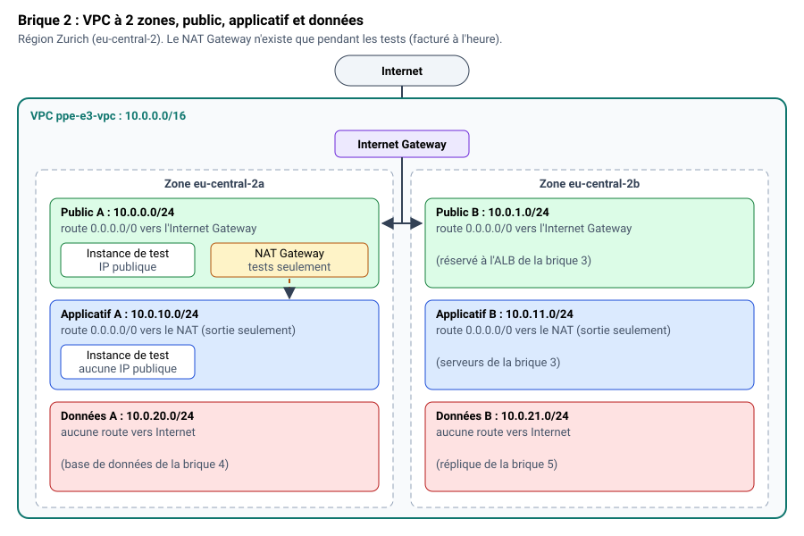

| Couche | Zone A | Zone B | Table de routage |
|---|---|---|---|
| Public | `10.0.0.0/24` | `10.0.1.0/24` | `0.0.0.0/0` vers l'Internet Gateway |
| Applicatif | `10.0.10.0/24` | `10.0.11.0/24` | `0.0.0.0/0` vers le NAT Gateway (sortie seulement) |
| Données | `10.0.20.0/24` | `10.0.21.0/24` | routes locales uniquement |

VPC `10.0.0.0/16`. Groupes de sécurité : `ppe-e3-sg-public` (TCP 80 depuis Internet) et
`ppe-e3-sg-prive` (TCP 80 **depuis le groupe public uniquement**). Aucune règle SSH : l'accès aux
serveurs se fait par Session Manager, avec un rôle limité à `AmazonSSMManagedInstanceCore`.

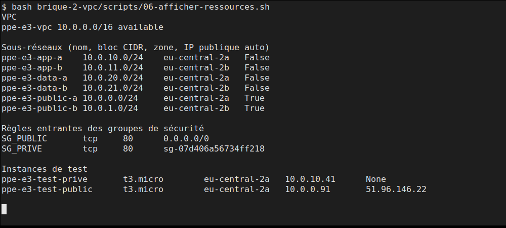

| # | Test | Résultat |
|---|---|---|
| T1 | l'instance privée n'a pas d'IP publique | `None` |
| T2 | instance publique depuis Internet | **200** |
| T3 | instance privée depuis Internet | **injoignable** (délai dépassé) |
| T4 | adresse de sortie de l'instance privée = adresse du NAT | **identiques** |
| T5 | instance publique vers instance privée | **200** |
| T6 | routes : publique vers IGW, app vers NAT, données locales seules | conforme |

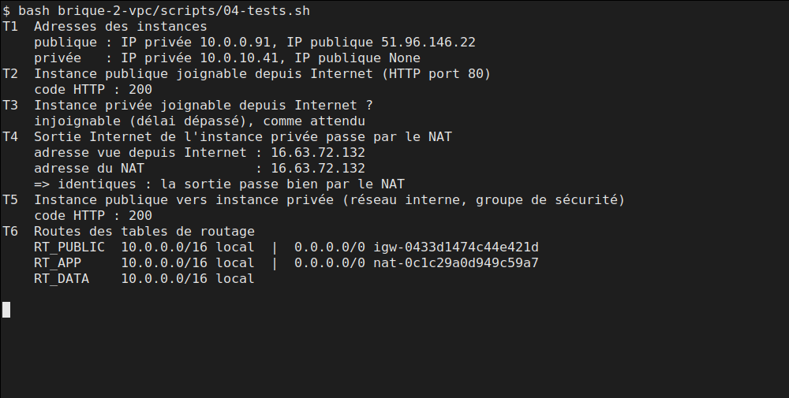

*Compromis :* un seul NAT Gateway (zone A) : le moins cher, mais sans tolérance à la panne de la zone
A ; en production, un NAT par zone.

*Coût :* NAT, IP élastique et 2 instances ont existé environ 8 minutes (11 h 02 à 11 h 10), puis ont
été supprimés par `05-nettoyage-quotidien.sh`. Le VPC, les sous-réseaux, l'Internet Gateway, les
tables de routage et les groupes de sécurité restent : ils ne coûtent rien.

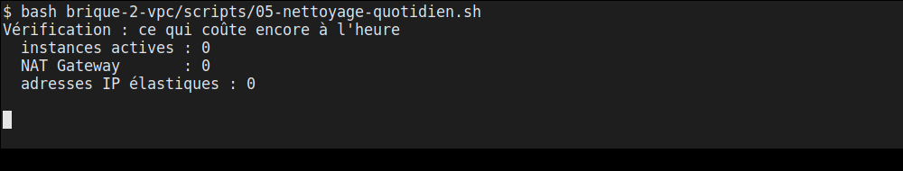

###   Brique 3 — EC2 + Application Load Balancer (projet 3)

À faire. Détail prévu dans [`brique-3-ec2-alb/`](brique-3-ec2-alb/README.md).

###   Brique 4 — Architecture 3 tiers avec RDS (projet 4)

Détail : [`brique-4-rds/`](brique-4-rds/README.md) (code dans [`app/`](brique-4-rds/app/))

*Fait :* l'application d'inscription (Flask, Gunicorn, PostgreSQL), écrite et testée en local avant
de toucher à AWS. Requêtes paramétrées (pas d'injection SQL), échappement HTML, validation côté
serveur, adresse e-mail jamais relue pour l'affichage, page 503 sans détail technique, conteneur sans
droits administrateur, contrôle de santé `/health` indépendant de la base. 13 tests automatiques
réussis.

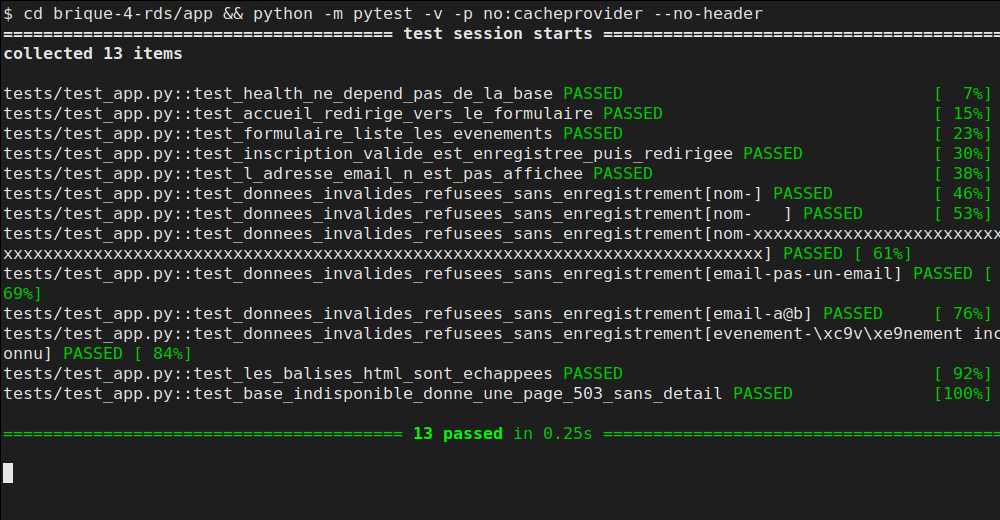

*À faire :* essai avec une vraie base PostgreSQL (`docker compose up`, le service Docker du poste
était arrêté), puis RDS dans les sous-réseaux « données », groupe de sécurité limité aux serveurs
applicatifs, mot de passe dans Secrets Manager.

###   Brique 5 — Résilience, IAM, supervision et coûts (projet 5)

À faire. Détail prévu dans [`brique-5-resilience/`](brique-5-resilience/README.md).

### Problèmes rencontrés (tous briques)

- **Descriptions de groupes de sécurité :** AWS n'accepte que de l'ASCII.
- **Ordre de création du NAT :** il doit exister, avec sa route, avant l'instance privée, sinon
  l'agent Systems Manager ne peut pas s'enregistrer.
- **Bucket privé :** il répond 403, et non 404, pour un fichier absent : deux règles d'erreur
  personnalisées sont nécessaires dans CloudFront.
- **Déploiement CloudFront :** plusieurs minutes avant de pouvoir tester.
- **Captures d'écran :** une capture de l'écran réel montrait d'autres fenêtres ; elles ont été
  supprimées et remplacées par des captures d'un terminal dans un écran virtuel isolé.
- **Docker :** service arrêté sur le poste, l'essai avec une vraie base reste à faire.

---

# Cahier des charges

Les sections suivantes décrivent le cahier des charges du projet : contexte, planning, règles, étapes
de chaque brique, rendu et barème.

## Contexte

Une association (fictive) organise des événements et veut une petite plateforme : un **site
vitrine** rapide, et une **application d'inscription** aux événements avec une base de données.
Elle veut démarrer simplement, puis rendre l'ensemble sûr et tolérant aux pannes.

Plutôt que 5 exercices séparés, on construit **une seule plateforme** : chaque brique ajoute une
couche à celle d'avant, et chaque couche correspond à un des 5 projets officiels.

```
Internet
   │
   ▼
CloudFront ──► S3 (site vitrine)                         ← Brique 1 (projet 1)
   │
   ▼  /inscription
Application Load Balancer (sous-réseaux publics, 2 AZ)   ← Brique 3 (projet 3)
   │
   ▼
EC2 ×2 (sous-réseaux privés « app », 1 par AZ)           ← Briques 3 et 5
   │
   ▼
RDS (sous-réseaux privés « données », Multi-AZ)          ← Briques 4 et 5 (projets 4 et 5)

Le tout dans un VPC à 2 zones de disponibilité           ← Brique 2 (projet 2)
IAM (moindre privilège) + CloudWatch + coûts             ← Brique 5 (projet 5)
```

## Correspondance avec les projets officiels

| Brique | Contenu | Projet officiel couvert | Niveau |
|---|---|---|---|
| 1 | Site statique S3 + CloudFront | Projet 1 | Débutant |
| 2 | VPC, sous-réseaux publics/privés, routage | Projet 2 | Débutant/Intermédiaire |
| 3 | EC2 ×2 derrière un Application Load Balancer | Projet 3 | Intermédiaire |
| 4 | RDS dans un sous-réseau privé, flux inter-tiers | Projet 4 | Intermédiaire/Avancé |
| 5 | Multi-AZ, IAM, CloudWatch, test de panne, coûts | Projet 5 | Avancé |

## Planning sur les 5 jours

Le niveau de départ (bases d'AWS et d'Azure déjà acquises) permet d'aller vite sur les briques 1 et
2. Le temps gagné va aux briques 4 et 5, les plus difficiles et les plus lourdes dans le barème.

| Jour | Travail | Brique |
|---|---|---|
| 1 | Site S3 + CloudFront (matin), puis VPC et preuves d'isolation (après-midi) | 1 et 2 |
| 2 | EC2 ×2, Application Load Balancer, groupes de sécurité chaînés, tests de répartition | 3 |
| 3 | RDS privé, application d'inscription, test de bout en bout | 4 |
| 4 | Multi-AZ (RDS et Auto Scaling Group), rôles et politiques IAM | 5 (première moitié) |
| 5 | Alarmes et tableau de bord CloudWatch, test de perte d'une zone, coûts, schéma final, nettoyage | 5 (seconde moitié) |

Le formulaire d'inscription (brique 4) peut être écrit et testé en local **avant** le jour 3, pour
ne pas y passer du temps sur AWS.

## Équivalents Azure

Pour chaque service utilisé, l'équivalent Azure : utile pour le rapport (comparaison des deux
clouds) et pour relier ce projet au cours Azure.

| Besoin | AWS (ce projet) | Azure |
|---|---|---|
| Site statique | S3 | Blob Storage (site web statique) |
| Distribution mondiale, HTTPS | CloudFront | Front Door ou Azure CDN |
| Réseau isolé | VPC et sous-réseaux | Réseau virtuel (VNet) et sous-réseaux |
| Sortie Internet des réseaux privés | NAT Gateway | NAT Gateway |
| Filtrage des flux | Groupes de sécurité | Groupes de sécurité réseau (NSG) |
| Serveurs | EC2 | Machines virtuelles |
| Répartition de charge (HTTP) | Application Load Balancer | Application Gateway |
| Parc de serveurs qui s'adapte | Auto Scaling Group | Virtual Machine Scale Sets |
| Base de données managée | RDS | Azure Database for MySQL ou PostgreSQL |
| Tolérance à la panne d'une zone | Multi-AZ | Zones de disponibilité, haute disponibilité redondante entre zones |
| Identités et droits | IAM (rôles, politiques) | Microsoft Entra ID, Azure RBAC, identités managées |
| Secrets | Secrets Manager | Key Vault |
| Supervision et alertes | CloudWatch, SNS | Azure Monitor, groupes d'actions |
| Accès aux serveurs sans SSH ouvert | Session Manager | Azure Bastion |
| Budget et coûts | AWS Budgets, calculateur AWS | Cost Management, calculateur de prix Azure |

## Règles pour tout le projet

- **Région :** `eu-central-2` (Zurich). Cette région n'est pas activée par défaut : il faut
  l'activer une fois (console, Account, AWS Regions, Enable). La disponibilité de chaque service
  est vérifiée avant de l'utiliser.
- **Accès aux serveurs :** via **AWS Systems Manager Session Manager**, sans ouvrir le port 22
  sur Internet. Si le SSH est utilisé, il est restreint à votre IP et justifié dans le rapport.
- **Nommage et étiquettes :** chaque ressource porte un nom `ppe-e3-<role>` et l'étiquette
  `Projet=ppe-e3`, ce qui permet de tout retrouver et tout supprimer.
- **Aucun secret dans le dépôt :** mots de passe et clés dans AWS Secrets Manager, jamais dans le
  code, les captures ou l'historique Git.

### Coûts : à lire avant de commencer

Certaines ressources sont **facturées à l'heure même sans trafic** : NAT Gateway, Application Load
Balancer, RDS (surtout en Multi-AZ), adresses IPv4 publiques. Les prix exacts sont à vérifier dans
le [calculateur AWS](https://calculator.aws/), ils changent selon la région.

1. **Jour 0 :** créer une alerte de budget (AWS Budgets, par exemple 10 CHF) et activer les
   notifications par e-mail.
2. **Chaque soir :** supprimer ou arrêter ce qui coûte à l'heure (NAT Gateway, ALB, RDS, instances).
   Un schéma décrit l'architecture : tout doit pouvoir être recréé le lendemain.
3. **Fin de semaine :** supprimer toutes les ressources portant l'étiquette `Projet=ppe-e3` et
   joindre au rapport une capture de la facture ou du Cost Explorer.

L'infrastructure en code (Terraform ou CloudFormation) est un **bonus** valorisé, mais pas une
obligation : elle rend le « recréer chaque matin » beaucoup plus simple.

---

## Brique 1 — Site vitrine sur S3 et CloudFront (projet 1)

**Objectif :** publier la page d'accueil de l'association en HTTPS, rapide, sans bucket public.

**Étapes**
1. Créer un bucket S3 **privé** (blocage de l'accès public activé) et y déposer un site HTML/CSS
   de 2 ou 3 pages (accueil, événements, contact).
2. Créer une distribution CloudFront avec ce bucket comme origine, accès via **Origin Access
   Control (OAC)**, et une politique de bucket qui n'autorise que cette distribution.
3. Rediriger HTTP vers HTTPS, définir `index.html` comme objet racine, ajouter une page d'erreur.
4. Tester : l'URL CloudFront répond, l'URL directe du bucket est refusée (403).

**Livrables :** URL CloudFront fonctionnelle, schéma S3 + CloudFront, politique de bucket,
captures des deux tests (accès par CloudFront accepté, accès direct refusé).

## Brique 2 — Le réseau : VPC à 2 zones, public et privé (projet 2)

**Objectif :** poser le réseau sur lequel tout le reste va tourner.

**Plan d'adressage de départ** (à justifier ou adapter dans le rapport)

| Sous-réseau | AZ A | AZ B | Rôle |
|---|---|---|---|
| Public | `10.0.0.0/24` | `10.0.1.0/24` | Load balancer, NAT |
| Privé « app » | `10.0.10.0/24` | `10.0.11.0/24` | Serveurs applicatifs |
| Privé « données » | `10.0.20.0/24` | `10.0.21.0/24` | Base de données |

VPC en `10.0.0.0/16`.

**Étapes**
1. Créer le VPC et les 6 sous-réseaux répartis sur 2 zones de disponibilité.
2. Internet Gateway et table de routage publique ; tables de routage privées **sans** route
   directe vers Internet.
3. Sortie Internet des sous-réseaux privés (mises à jour système) via **1 NAT Gateway** dans un
   sous-réseau public. Noter dans le rapport le compromis coût / résilience (1 NAT ou 1 par AZ).
4. Lancer une petite instance de test dans un sous-réseau public et une dans un sous-réseau privé.
5. Prouver l'isolation : l'instance privée n'est pas joignable depuis Internet, mais peut sortir
   par le NAT ; l'instance publique est joignable comme prévu.

**Livrables :** VPC opérationnel, schéma réseau annoté (CIDR, AZ, tables de routage), preuves
d'isolation (sorties de commandes ou captures).

## Brique 3 — Serveurs web derrière un Application Load Balancer (projet 3)

**Objectif :** ne plus dépendre d'un seul serveur.

**Étapes**
1. Lancer **2 instances EC2** (1 par AZ) dans les sous-réseaux **privés « app »**, avec un serveur
   web installé par script de démarrage (user data). La page doit afficher l'identifiant de
   l'instance et sa zone de disponibilité, pour voir quel serveur répond.
2. Créer un Application Load Balancer dans les sous-réseaux **publics**, un groupe cible, et un
   contrôle de santé (par exemple `/health`).
3. Groupes de sécurité **chaînés** : Internet → ALB (80/443) ; ALB → instances (80 uniquement,
   depuis le groupe de sécurité de l'ALB, pas depuis une plage d'adresses).
4. Tester la répartition : actualiser plusieurs fois et constater l'alternance des instances.
5. Tester la tolérance : arrêter un serveur, vérifier que le site répond toujours et que la cible
   passe en `unhealthy`.

**Livrables :** infrastructure EC2 + ALB, schéma mis à jour, tableau des règles de sécurité,
preuve de répartition (captures ou `curl` en boucle) et du retrait d'une cible défaillante.

## Brique 4 — Architecture 3 tiers avec RDS (projet 4)

**Objectif :** ajouter la base de données et l'application d'inscription.

**Étapes**
1. Créer un **DB subnet group** avec les deux sous-réseaux privés « données ».
2. Déployer **RDS** (MySQL ou PostgreSQL, petite taille) : non accessible publiquement, chiffré,
   un seul mode AZ pour l'instant (le Multi-AZ vient à la brique 5).
3. Stocker le mot de passe dans **Secrets Manager** ; l'application le lit au démarrage.
4. Groupe de sécurité de la base : entrée **uniquement** depuis le groupe de sécurité des serveurs
   applicatifs, sur le port de la base. Aucune autre règle.
5. Application minimale sur les serveurs : formulaire d'inscription à un événement, enregistrement
   en base, liste des inscrits. Un langage simple suffit (Python/Flask par exemple).
6. Test de bout en bout : s'inscrire depuis le navigateur, voir la ligne en base, et prouver que la
   base est injoignable depuis Internet **et** depuis un sous-réseau qui n'est pas le sien.
7. *Bonus d'intégration :* faire servir le chemin `/inscription/*` par CloudFront vers l'ALB, le
   reste restant servi par S3 : un seul nom de domaine pour tout le site.

**Livrables :** architecture 3 tiers opérationnelle, schéma complet, documentation des règles de
sécurité entre les tiers (qui parle à qui, sur quel port, pourquoi).

## Brique 5 — Résilience, IAM, supervision et coûts (projet 5)

**Objectif :** rendre l'ensemble tolérant à la panne d'une zone et le surveiller.

**Étapes**
1. **Multi-AZ :** passer RDS en Multi-AZ ; remplacer les 2 instances par un **Auto Scaling Group**
   (minimum 2, réparti sur les 2 AZ) branché sur le groupe cible de l'ALB.
2. **IAM, moindre privilège :** un rôle par composant (instance applicative : lire *ce* secret et
   rien d'autre, plus l'accès Session Manager ; etc.). Aucune politique `*:*`. Justifier chaque
   permission dans le rapport.
3. **CloudWatch :** alarmes sur le CPU des instances, le nombre de cibles saines de l'ALB, les
   erreurs 5xx, les connexions et l'espace disque de RDS ; un tableau de bord regroupant ces métriques ;
   notification par e-mail (SNS).
4. **Test de panne :** simuler la perte d'une zone (arrêter les instances d'une AZ, forcer un
   basculement RDS). Mesurer et noter la durée d'indisponibilité, vérifier que l'inscription
   fonctionne encore, vérifier que les alarmes se déclenchent.
5. **Coûts :** estimation du coût mensuel dans le calculateur AWS (export joint), avec 3 pistes
   d'optimisation chiffrées (taille d'instance, NAT unique, arrêt hors heures de bureau, etc.).
   *Bonus :* chiffrer la même architecture dans le calculateur de prix Azure (voir « Équivalents
   Azure ») et comparer les deux montants.
6. Schéma final et nettoyage complet des ressources.

**Livrables :** architecture multi-AZ testée, politiques IAM, tableau de bord CloudWatch, résultat
du test de panne, estimation de coût mensuel, schéma final.

---

## Rendu

Un dépôt Git avec un seul README principal et un sous-dossier par brique :

```
aws-ppe-e3/
├── README.md                    # ce document : rapport de réalisation et cahier des charges
├── brique-0-preparation/        # outils, connexion, budget, IAM : README, captures, iam/
├── brique-1-s3-cloudfront/      # site/, config/, captures/, README
├── brique-2-vpc/                # scripts/, captures/, README
├── brique-3-ec2-alb/            # à faire
├── brique-4-rds/                # app/ (Flask), captures/, README
├── brique-5-resilience/         # à faire
├── schemas/                     # un schéma par brique, plus le schéma final
├── captures-console.md          # liste des captures de la console AWS
└── couts/                       # export du calculateur AWS, capture de la facture (à faire)
```

Chaque dossier de brique contient : ce qui a été fait, les commandes ou réglages importants, les
tests réalisés **avec leur résultat**, et les problèmes rencontrés. Selon la consigne des fiches
officielles, le rendu est déposé dans un sous-dossier `rendu-<nom-etudiant>/` à côté des fiches du
cours (voir `03-cloud-aws/README.md`).

## Barème

Même échelle que les fiches officielles : note sur 6, `Note = 1 + (% obtenu / 100) × 5`, seuil de
réussite **4.0/6** (60 %). Le formateur peut ajuster la répartition ci-dessous.

| Critère | Pondération |
|---|---|
| Brique 1 — S3 + CloudFront (bucket privé, HTTPS, tests) | 5% |
| Brique 2 — VPC et preuves d'isolation | 10% |
| Brique 3 — EC2 + ALB, groupes de sécurité chaînés, répartition prouvée | 15% |
| Brique 4 — RDS privé, flux inter-tiers, application de bout en bout | 25% |
| Brique 5 — Multi-AZ, IAM moindre privilège, CloudWatch, test de panne | 30% |
| Documentation, schéma final, coûts et nettoyage | 15% |

### Si le temps manque

Les briques se construisent les unes sur les autres : mieux vaut une brique 4 terminée et testée qu'une
brique 5 bâclée. Ordre de sacrifice conseillé, à annoncer au formateur plutôt qu'à subir :
1. le bonus d'intégration CloudFront → ALB et l'infrastructure en code ;
2. l'Auto Scaling Group (garder 2 instances fixes, une par AZ) ;
3. le tableau de bord CloudWatch (garder les alarmes) ;
4. en dernier recours, s'arrêter à la brique 4 et documenter précisément la brique 5 comme travail
   restant.

## Ressources

- [AWS — Amazon S3 User Guide](https://docs.aws.amazon.com/AmazonS3/latest/userguide/Welcome.html)
- [AWS — CloudFront : restreindre l'accès à une origine S3 (OAC)](https://docs.aws.amazon.com/AmazonCloudFront/latest/DeveloperGuide/private-content-restricting-access-to-s3.html)
- [AWS — Amazon VPC User Guide](https://docs.aws.amazon.com/vpc/latest/userguide/what-is-amazon-vpc.html)
- [AWS — Amazon EC2 User Guide](https://docs.aws.amazon.com/ec2/index.html)
- [AWS — Elastic Load Balancing User Guide](https://docs.aws.amazon.com/elasticloadbalancing/latest/userguide/what-is-load-balancing.html)
- [AWS — Amazon RDS User Guide](https://docs.aws.amazon.com/AmazonRDS/latest/UserGuide/Welcome.html)
- [AWS — IAM User Guide](https://docs.aws.amazon.com/IAM/latest/UserGuide/introduction.html)
- [AWS — Amazon CloudWatch User Guide](https://docs.aws.amazon.com/AmazonCloudWatch/latest/monitoring/WhatIsCloudWatch.html)
- [AWS Well-Architected Framework](https://docs.aws.amazon.com/wellarchitected/latest/framework/welcome.html)
- [AWS Pricing Calculator](https://calculator.aws/)
