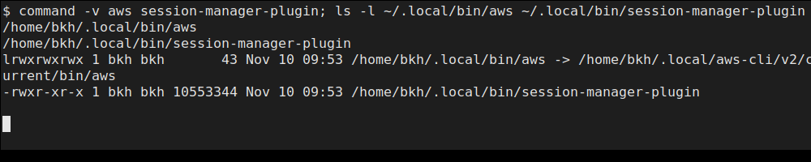
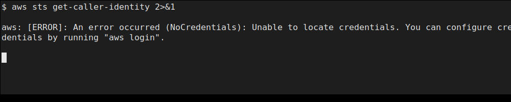
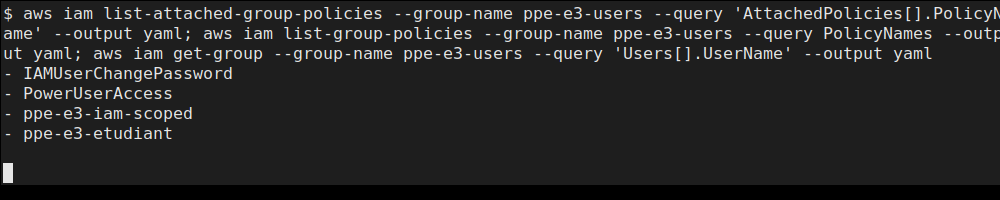
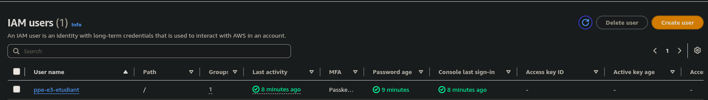
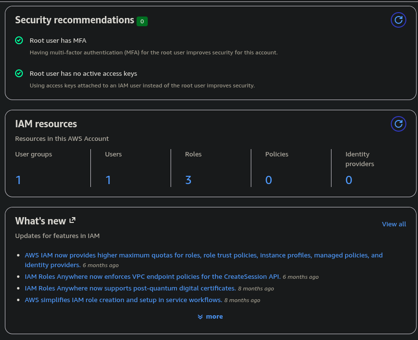
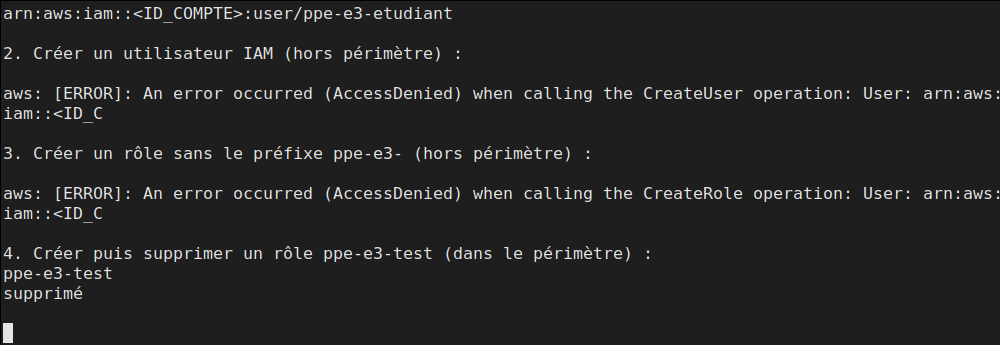

# Brique 0 — Préparation du poste

Installation des outils en ligne de commande sur le poste de travail (Pop!_OS 24.04, x86_64).
Tout est installé **dans le dossier personnel**, sans `sudo` et sans toucher au système.

## 1. AWS CLI v2

```bash
curl -fsSL -o awscliv2.zip https://awscli.amazonaws.com/awscli-exe-linux-x86_64.zip
unzip -q awscliv2.zip
./aws/install -i "$HOME/.local/aws-cli" -b "$HOME/.local/bin"
```

Vérification :

```console
$ aws --version
aws-cli/2.39.7 Python/3.14.8 Linux/7.2.15-76070215-generic exe/x86_64.pop.24
```


## 2. Plugin Session Manager

Le plugin permet d'ouvrir une session sur une instance privée sans ouvrir le port 22. Le paquet
`.deb` officiel est extrait puis le binaire est copié dans `~/.local/bin` :

```bash
curl -fsSL -o session-manager-plugin.deb \
  https://s3.amazonaws.com/session-manager-downloads/plugin/latest/ubuntu_64bit/session-manager-plugin.deb
dpkg-deb -x session-manager-plugin.deb extracted
cp extracted/usr/local/sessionmanagerplugin/bin/session-manager-plugin "$HOME/.local/bin/"
```

Vérification :

```console
$ session-manager-plugin --version
1.2.896.0
```


Les deux outils sont bien trouvés dans le `PATH` et installés dans le dossier personnel :



## 3. État des identifiants (avant connexion)

Avant la connexion, aucun identifiant AWS n'est configuré, ce qui est attendu :

```console
$ aws sts get-caller-identity
aws: [ERROR]: An error occurred (NoCredentials): Unable to locate credentials.
```



## 4. Connexion au compte et région

La connexion se fait avec `aws login`, qui ouvre la page de connexion AWS dans le navigateur : les
identifiants sont saisis par l'étudiant sur cette page, jamais dans le terminal ni dans le dépôt.
À l'invite, la région choisie est **`eu-central-2` (Zurich)**.

```console
$ aws login
AWS Region [us-east-1]: eu-central-2
...
$ aws sts get-caller-identity      # renvoie bien le compte
$ aws configure get region
eu-central-2
$ aws ec2 describe-availability-zones --region eu-central-2
eu-central-2a  available
eu-central-2b  available
eu-central-2c  available
```

La région Zurich est active et offre 3 zones de disponibilité, ce qui suffit pour le Multi-AZ.

> La connexion initiale utilise le compte racine, réservé à la configuration du compte. Pour la
> suite du projet, un utilisateur IAM à droits limités est créé (section 7).

## 5. Plan gratuit et coûts

Le compte est sur le **plan gratuit AWS** avec des crédits, consultable en ligne de commande :

```bash
aws freetier get-account-plan-state --region us-east-1
```


Le plan est `FREE` et actif, avec 100 USD de crédits restants jusqu'au 10 mai 2027. Les crédits
sont consommés par l'usage : NAT Gateway, Application Load Balancer et RDS sont facturés à
l'heure, d'où l'alerte de budget ci-dessous et le nettoyage quotidien prévu dans le README
principal.

## 6. Alerte de budget (« jour 0 »)

Un budget mensuel de 10 USD, **sans déduire les crédits** (pour suivre la consommation réelle),
avec deux alertes par e-mail à 80 % et à 100 % de la dépense réelle. Les fichiers JSON de
configuration sont écrits à part et ne sont pas versionnés (ils contiennent l'adresse e-mail).

```bash
aws budgets create-budget --account-id "$ACCOUNT_ID" \
  --budget file://budget.json \
  --notifications-with-subscribers file://notifs.json
```

Points importants de `budget.json` : `BudgetType: COST`, `TimeUnit: MONTHLY`, limite `10` en
`USD`, et `CostTypes.IncludeCredit: false`.

Vérification du budget puis de ses alertes :


Le même budget dans la console AWS (état « Healthy », 0 USD utilisé) :


## 7. Utilisateur IAM à droits limités

Le compte racine n'est pas utilisé au quotidien. Un groupe et un utilisateur sont créés en ligne de
commande :

| Élément | Valeur |
|---|---|
| Groupe | `ppe-e3-users` |
| Utilisateur | `ppe-e3-etudiant` (étiquette `Projet=ppe-e3`) |
| Politique gérée `PowerUserAccess` | tous les services AWS, **sauf** la gestion IAM |
| Politique gérée `IAMUserChangePassword` | l'utilisateur peut changer son mot de passe |
| Politique `ppe-e3-iam-scoped` | gestion IAM limitée aux rôles, politiques et profils nommés `ppe-e3-*`, `iam:PassRole` limité à ces rôles, gestion de son propre MFA, interdiction d'attacher `AdministratorAccess` |

La politique est versionnée avec un identifiant de compte factice :
[`iam/ppe-e3-iam-scoped.json`](iam/ppe-e3-iam-scoped.json) (`<ACCOUNT_ID>` est remplacé à la
création). Elle applique déjà le principe du moindre privilège, qui sera développé pour les rôles
des serveurs à la brique 5.



Dans la console, l'utilisateur apparaît avec son MFA (une passkey), son mot de passe et sa
première connexion :



Le tableau de bord IAM confirme que le compte racine a un MFA et aucune clé d'accès active :



Le mot de passe de console et le MFA de l'utilisateur (une passkey) sont configurés par l'étudiant
dans la console : rien de secret n'est écrit dans le dépôt. La CLI est ensuite reconnectée avec
cet utilisateur (`aws login`) et n'utilise plus le compte racine.

### Preuve des droits limités

Script de test (identifiant de compte masqué dans l'affichage) :

| # | Action | Attendu | Résultat |
|---|---|---|---|
| 1 | `aws sts get-caller-identity` | utilisateur `ppe-e3-etudiant` | conforme |
| 2 | `aws iam create-user --user-name test-refus` | refusé (hors périmètre) | `AccessDenied` |
| 3 | `aws iam create-role --role-name autre-role …` | refusé (pas de préfixe `ppe-e3-`) | `AccessDenied` |
| 4 | `aws iam create-role --role-name ppe-e3-test …` puis `delete-role` | autorisé (dans le périmètre) | créé puis supprimé |
| 5 | lecture du budget et de la distribution CloudFront | autorisée (PowerUser) | conforme |



## À faire ensuite

- [x] Créer ou récupérer le compte AWS (compte personnel, plan gratuit).
- [x] Créer l'alerte de budget (« jour 0 » du README principal).
- [x] Configurer les identifiants (`aws login`, saisis par l'étudiant sur la page AWS).
- [x] Vérifier avec `aws sts get-caller-identity`.
- [x] Créer un utilisateur IAM à droits limités (`ppe-e3-etudiant`).
- [x] Activer le MFA sur le compte racine (par l'étudiant, dans la console).
- [x] Définir le mot de passe de console de `ppe-e3-etudiant` et activer son MFA (par l'étudiant).
- [x] Se reconnecter avec cet utilisateur (`aws login`) et ne plus utiliser le compte racine.
- [x] Captures de la console AWS (budget, utilisateur IAM avec son MFA, MFA du compte racine).

## Captures

Les images de `captures/` sont de vraies captures d'un terminal exécutant les vraies commandes
ci-dessus (dans un écran virtuel isolé, pour ne montrer que le terminal). Les captures de la
console AWS (briques 1 à 5) seront ajoutées dans le dossier de chaque brique.
