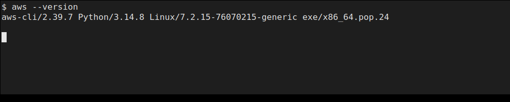
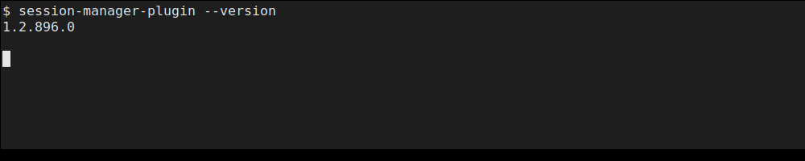

# Brique 0 — Préparation du poste

Installation des outils en ligne de commande sur le poste de travail (Pop!_OS 24.04, x86_64).
Tout est installé **dans le dossier personnel**, sans `sudo` et sans toucher au système.

## 1. AWS CLI v2

```bash
curl -fsSL -o awscliv2.zip https://awscli.amazonaws.com/awscli-exe-linux-x86_64.zip
unzip -q awscliv2.zip
./aws/install -i "$HOME/.local/aws-cli" -b "$HOME/.local/bin"
```

Vérification :

```console
$ aws --version
aws-cli/2.39.7 Python/3.14.8 Linux/7.2.15-76070215-generic exe/x86_64.pop.24
```



## 2. Plugin Session Manager

Le plugin permet d'ouvrir une session sur une instance privée sans ouvrir le port 22. Le paquet
`.deb` officiel est extrait puis le binaire est copié dans `~/.local/bin` :

```bash
curl -fsSL -o session-manager-plugin.deb \
  https://s3.amazonaws.com/session-manager-downloads/plugin/latest/ubuntu_64bit/session-manager-plugin.deb
dpkg-deb -x session-manager-plugin.deb extracted
cp extracted/usr/local/sessionmanagerplugin/bin/session-manager-plugin "$HOME/.local/bin/"
```

Vérification :

```console
$ session-manager-plugin --version
1.2.896.0
```



Les deux outils sont bien trouvés dans le `PATH` et installés dans le dossier personnel :


## 3. État des identifiants

Aucun identifiant AWS n'est encore configuré, ce qui est attendu :

```console
$ aws sts get-caller-identity
aws: [ERROR]: An error occurred (NoCredentials): Unable to locate credentials.
```


## À faire ensuite

- [ ] Créer ou récupérer le compte AWS (à confirmer : compte de l'école ou compte personnel).
- [ ] Créer l'alerte de budget (« jour 0 » du README principal).
- [ ] Configurer les identifiants (`aws configure`, saisis par l'étudiant, jamais versionnés).
- [ ] Vérifier avec `aws sts get-caller-identity`.

## Captures

Les images de `captures/` sont de vraies captures d'un terminal exécutant les vraies commandes
ci-dessus (dans un écran virtuel isolé, pour ne montrer que le terminal). Les captures de la
console AWS (briques 1 à 5) seront ajoutées dans le dossier de chaque brique.
