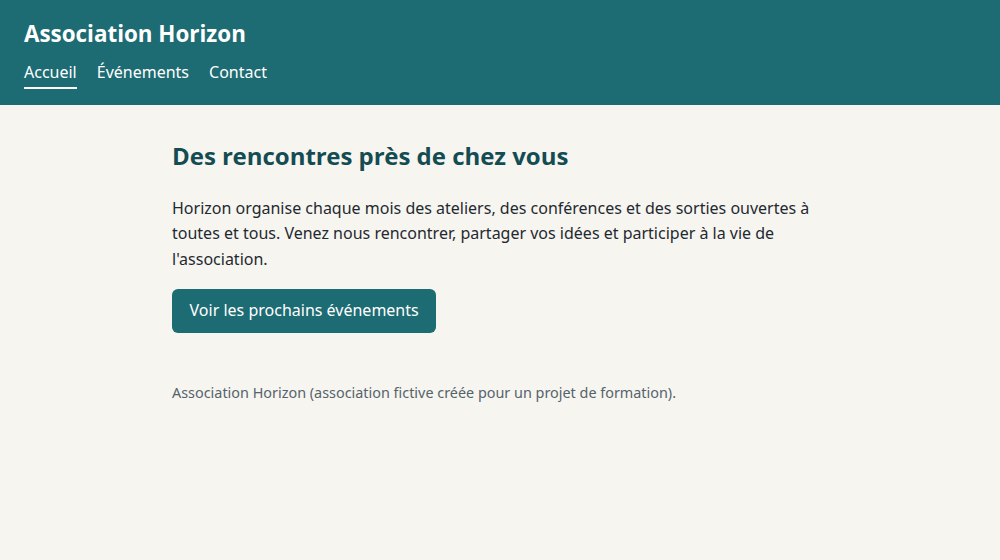
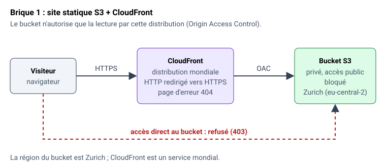
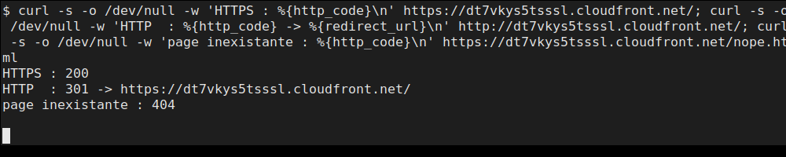
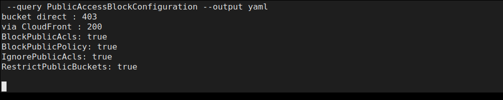
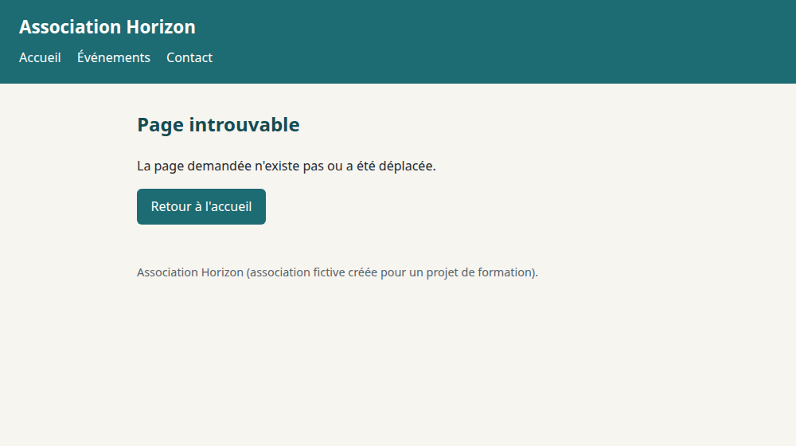
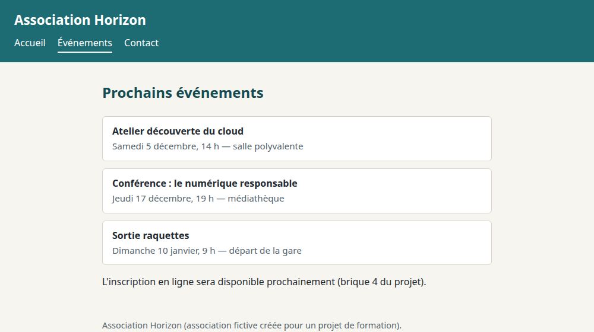
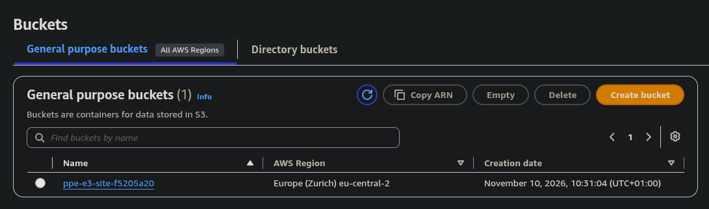
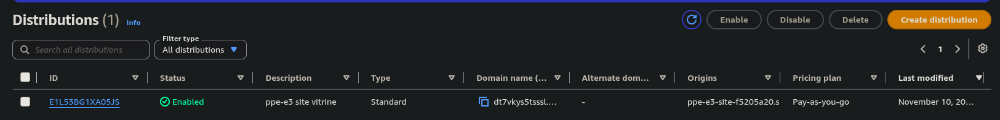
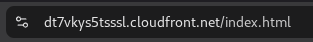

# Brique 1 — Site vitrine sur S3 et CloudFront

Projet officiel couvert : projet 1 (site statique sur S3 et CloudFront).

## Résultat

Le site de l'association « Horizon » (4 pages HTML + une feuille de style, dans [`site/`](site/)) est
servi en **HTTPS** par CloudFront. Le bucket S3 est **privé** : seule la distribution CloudFront
peut lire ses fichiers.



## Architecture



| Élément | Choix | Pourquoi |
|---|---|---|
| Bucket S3 | région `eu-central-2` (Zurich), accès public bloqué, chiffrement SSE-S3, étiquette `Projet=ppe-e3` | données en Suisse, aucun accès direct possible |
| Accès du CDN au bucket | **Origin Access Control (OAC)**, signature SigV4 | méthode actuelle recommandée, remplace l'ancien Origin Access Identity |
| CloudFront | `redirect-to-https`, objet racine `index.html`, compression, HTTP/2 et HTTP/3, classe de prix `PriceClass_100` | HTTPS forcé, performance, coût réduit |
| Pages introuvables | les erreurs 403 et 404 de l'origine renvoient `/error.html` avec le code 404 | un bucket privé répond 403 pour un fichier absent : sans cela le visiteur verrait une erreur XML |
| Certificat | certificat par défaut `*.cloudfront.net` | pas de nom de domaine personnalisé dans ce projet |

### Écart avec la fiche officielle

La fiche demande de « configurer l'hébergement de site web statique sur le bucket ». Je n'active
**pas** cette fonction : elle impose un bucket lisible publiquement et ne sert qu'en HTTP. Le choix
retenu (bucket privé + OAC) répond mieux à l'objectif de la fiche, « sécuriser l'accès au bucket
(accès public contrôlé, HTTPS) », et c'est la méthode recommandée par AWS.

## Réalisation en ligne de commande

Les valeurs entre chevrons sont propres au compte et ne sont pas versionnées.
Les fichiers JSON utilisés sont dans [`config/`](config/).

```bash
# 1. Bucket privé à Zurich, accès public bloqué, chiffré, étiqueté
aws s3api create-bucket --bucket <NOM_DU_BUCKET> --region eu-central-2 \
  --create-bucket-configuration LocationConstraint=eu-central-2
aws s3api put-public-access-block --bucket <NOM_DU_BUCKET> \
  --public-access-block-configuration BlockPublicAcls=true,IgnorePublicAcls=true,BlockPublicPolicy=true,RestrictPublicBuckets=true
aws s3api put-bucket-encryption --bucket <NOM_DU_BUCKET> \
  --server-side-encryption-configuration '{"Rules":[{"ApplyServerSideEncryptionByDefault":{"SSEAlgorithm":"AES256"}}]}'
aws s3api put-bucket-tagging --bucket <NOM_DU_BUCKET> --tagging 'TagSet=[{Key=Projet,Value=ppe-e3}]'

# 2. Envoi du site
aws s3 sync site/ s3://<NOM_DU_BUCKET> --delete --region eu-central-2

# 3. Origin Access Control
aws cloudfront create-origin-access-control --origin-access-control-config \
  'Name=ppe-e3-oac,SigningProtocol=sigv4,SigningBehavior=always,OriginAccessControlOriginType=s3'

# 4. Distribution CloudFront (config/cloudfront-distribution.json)
aws cloudfront create-distribution-with-tags --distribution-config-with-tags file://cloudfront-distribution.json

# 5. Politique du bucket : lecture réservée à cette distribution (config/bucket-policy.json)
aws s3api put-bucket-policy --bucket <NOM_DU_BUCKET> --policy file://bucket-policy.json --region eu-central-2

# 6. Attendre le déploiement (quelques minutes)
aws cloudfront wait distribution-deployed --id <ID_DISTRIBUTION>
```

L'ordre compte : la politique du bucket cite l'identifiant de la distribution, elle est donc créée
**après** elle.

## Tests et preuves

| # | Test | Attendu | Résultat |
|---|---|---|---|
| 1 | `https://<domaine>.cloudfront.net/` | 200, page d'accueil | **200** |
| 2 | `https://<domaine>.cloudfront.net/evenements.html` | 200 | **200** |
| 3 | `http://<domaine>.cloudfront.net/` | redirection vers HTTPS | **301** vers `https://…` |
| 4 | `https://<domaine>.cloudfront.net/nope.html` | page d'erreur personnalisée, code 404 | **404** + `error.html` |
| 5 | accès direct `https://<bucket>.s3.eu-central-2.amazonaws.com/index.html` | refusé | **403** |
| 6 | `get-bucket-policy-status` | bucket non public | `IsPublic: False` |
| 7 | en-têtes de la réponse | passage par CloudFront, cache actif | `x-cache: Hit from cloudfront` |









### Dans la console AWS

Le bucket, créé à Zurich :



La distribution CloudFront, activée, avec le bucket comme origine :



Le site ouvert dans le navigateur à l'adresse CloudFront :



## Coûts et nettoyage

S3 et CloudFront ne facturent que l'usage (quelques fichiers et très peu de trafic) : la brique 1 ne
coûte quasiment rien à laisser en ligne. Tout porte l'étiquette `Projet=ppe-e3` ou le préfixe
`ppe-e3-` pour un nettoyage complet en fin de semaine : vider puis supprimer le bucket, désactiver
puis supprimer la distribution, supprimer l'OAC.

## Problèmes rencontrés

- Le déploiement d'une distribution CloudFront prend plusieurs minutes : les tests ne sont possibles
  qu'une fois l'état `Deployed` (voir la commande `wait` ci-dessus).
- Un bucket privé renvoie **403** (et non 404) pour un fichier absent, d'où les deux règles d'erreur
  personnalisées de la distribution.
- Le nom d'un bucket S3 est unique dans le monde entier : un suffixe aléatoire est ajouté au nom
  `ppe-e3-site-`.
