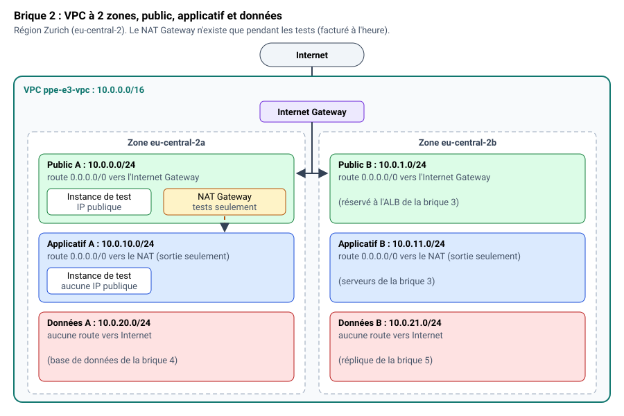
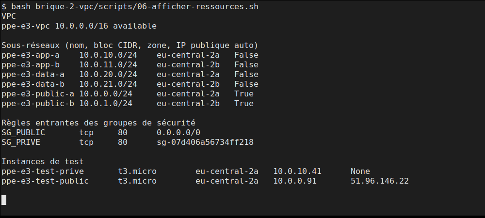
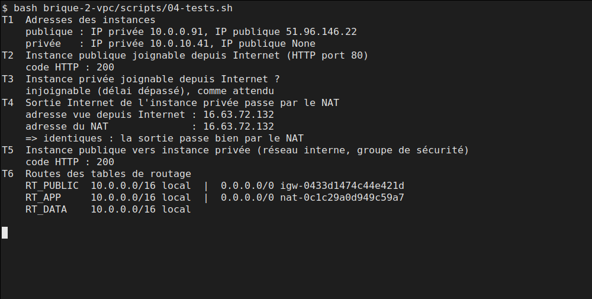
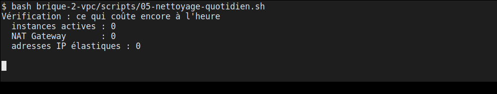

# Brique 2 — VPC à 2 zones, public et privé

Projet officiel couvert : projet 2 (VPC avec sous-réseaux publics et privés).

## Résultat

Un VPC `10.0.0.0/16` à Zurich, réparti sur **2 zones de disponibilité**, avec trois couches de
sous-réseaux : publique, applicative et données. Deux instances de test ont prouvé que :

- l'instance **publique** est joignable depuis Internet ;
- l'instance **privée** ne l'est pas, mais **sort** sur Internet par le NAT Gateway ;
- les sous-réseaux **données** n'ont aucune route vers Internet.

## Plan d'adressage

Le VPC en `/16` laisse de la place : chaque sous-réseau est un `/24` (251 adresses utilisables, AWS
en réserve 5), et les blocs sont groupés par rôle pour qu'une règle de sécurité ou de routage se lise
d'un coup d'œil.

| Couche | Zone A | Zone B | Rôle (brique) |
|---|---|---|---|
| Public | `10.0.0.0/24` | `10.0.1.0/24` | load balancer et NAT (3) |
| Applicatif | `10.0.10.0/24` | `10.0.11.0/24` | serveurs web (3) |
| Données | `10.0.20.0/24` | `10.0.21.0/24` | base de données RDS (4 et 5) |

Chaque couche a sa propre table de routage :

| Table | Routes | Pourquoi |
|---|---|---|
| `ppe-e3-rt-public` | locale + `0.0.0.0/0` vers l'**Internet Gateway** | accessible depuis Internet |
| `ppe-e3-rt-app` | locale + `0.0.0.0/0` vers le **NAT Gateway** | sortie pour les mises à jour, aucune entrée |
| `ppe-e3-rt-data` | **locale uniquement** | la base ne peut ni sortir ni être jointe depuis Internet |

## Groupes de sécurité

| Groupe | Entrée | Pourquoi |
|---|---|---|
| `ppe-e3-sg-public` | TCP 80 depuis `0.0.0.0/0` | serveur de test public |
| `ppe-e3-sg-prive` | TCP 80 **depuis `ppe-e3-sg-public` uniquement** | le serveur privé ne répond qu'au groupe public, pas à une plage d'adresses |

**Aucune règle SSH.** L'accès aux serveurs se fait par **Systems Manager (Session Manager)**, avec un
rôle `ppe-e3-ssm-role` qui n'a que la politique gérée `AmazonSSMManagedInstanceCore`. Aucun port 22
ouvert sur Internet.

## Réalisation

Tout est fait en ligne de commande avec les scripts de [`scripts/`](scripts/), qui servent aussi de
documentation et permettent de recréer l'ensemble :

| Script | Rôle | Facturation |
|---|---|---|
| `01-reseau.sh` | VPC, 6 sous-réseaux, Internet Gateway, 3 tables de routage | gratuit |
| `02-securite-ssm.sh` | rôle SSM, profil d'instance, 2 groupes de sécurité | gratuit |
| `03-instances-nat.sh` | adresse IP élastique, NAT Gateway, 2 instances `t3.micro` | **à l'heure** |
| `04-tests.sh` | tests d'isolation et de routage | gratuit |
| `05-nettoyage-quotidien.sh` | supprime ce qui est facturé à l'heure | libère |
| `06-afficher-ressources.sh` | résumé des ressources (pour les captures) | gratuit |

Les identifiants créés sont écrits dans `scripts/ids.env`, non versionné.

## Tests et preuves

| # | Test | Attendu | Résultat |
|---|---|---|---|
| T1 | adresses des instances | la privée n'a **pas** d'IP publique | `None` |
| T2 | `curl http://<IP publique>/` depuis Internet | accessible | **200** |
| T3 | `curl http://<IP privée>/` depuis Internet | injoignable | **délai dépassé** |
| T4 | adresse de sortie vue depuis Internet, commande lancée sur l'instance privée (`checkip.amazonaws.com`) | identique à l'adresse du NAT | **identiques** |
| T5 | instance publique vers instance privée (`curl` sur l'IP privée) | autorisé par le groupe de sécurité | **200** |
| T6 | routes des tables | public : Internet Gateway, app : NAT, données : locale seule | conforme |

T4 est la preuve que la sortie de l'instance privée passe par le NAT : l'adresse qu'Internet voit est
celle du NAT, pas celle de l'instance.

## Compromis coût et résilience du NAT

Un seul NAT Gateway est créé, dans la zone A. C'est le choix le moins cher, mais si la zone A tombe,
les sous-réseaux applicatifs de la zone B perdent leur sortie Internet. En production, on crée **un
NAT par zone** (une table de routage applicative par zone). Ici, un seul suffit : le NAT n'existe que
pendant les tests, et la brique 5 documente ce compromis.

## Coûts et nettoyage

Le NAT Gateway, l'adresse IP élastique et les instances sont **facturés à l'heure même sans trafic**.
Ils ont existé environ 8 minutes (de 11 h 02 à 11 h 10), puis ont été supprimés avec
`05-nettoyage-quotidien.sh`, qui vérifie ensuite qu'il ne reste rien :

Le VPC, les sous-réseaux, l'Internet Gateway, les tables de routage et les groupes de sécurité ne
coûtent rien : ils restent en place pour les briques suivantes.

## Problèmes rencontrés

- **Description d'un groupe de sécurité :** AWS n'accepte que de l'ASCII. Une description avec un
  accent est refusée, d'où des descriptions sans accents dans le script.
- **Ordre de création :** le NAT doit exister, avec sa route, **avant** de lancer l'instance privée :
  sans sortie Internet, l'agent Systems Manager ne peut pas s'enregistrer et l'instance reste
  inaccessible. Le script attend aussi que les 2 instances soient `Online` dans Systems Manager.
- **Utilisateur limité :** la création du rôle `ppe-e3-ssm-role` fonctionne avec l'utilisateur IAM du
  projet, ce qui confirme que la politique `ppe-e3-iam-scoped` autorise bien les rôles `ppe-e3-*`.
