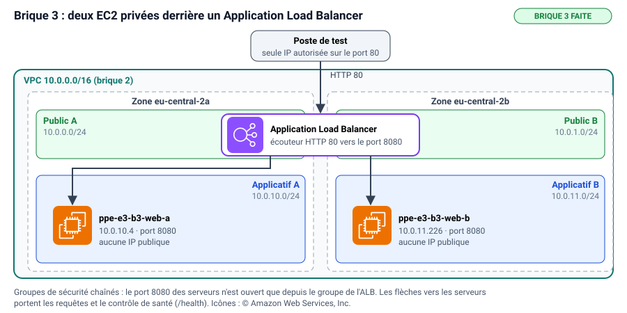
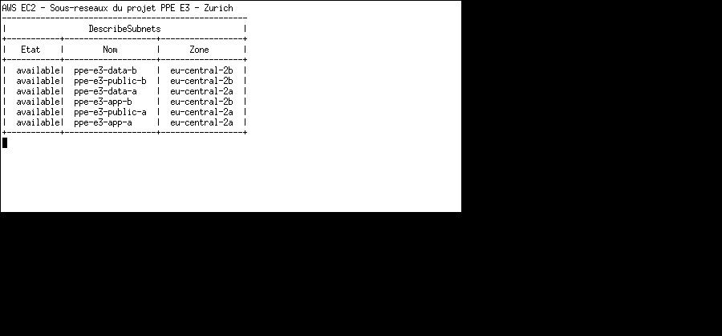
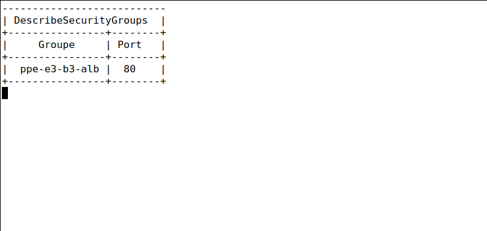
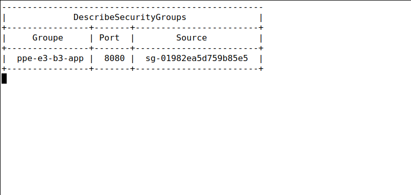
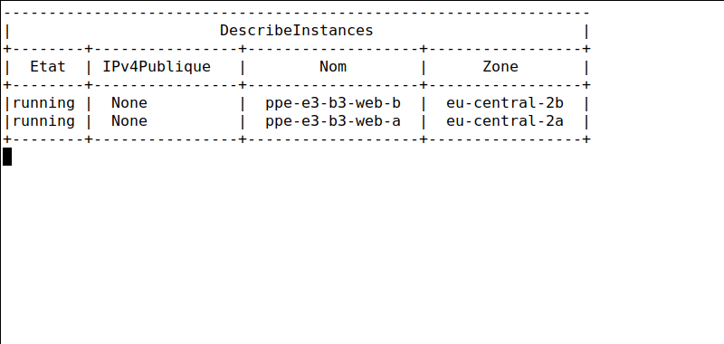
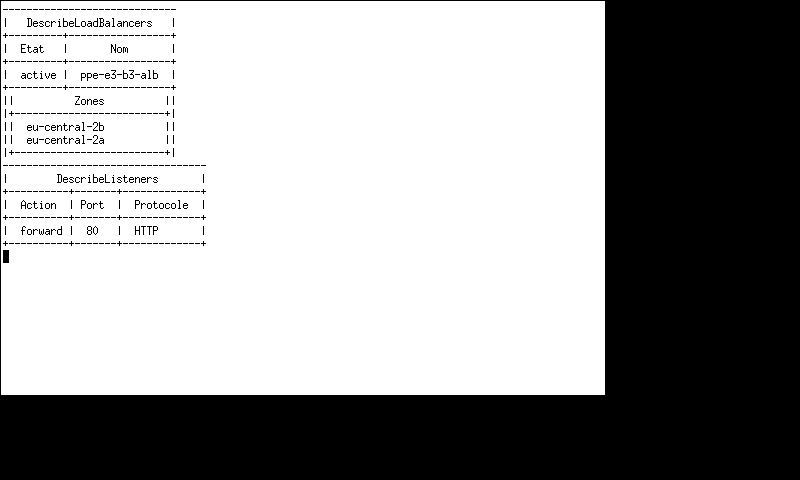
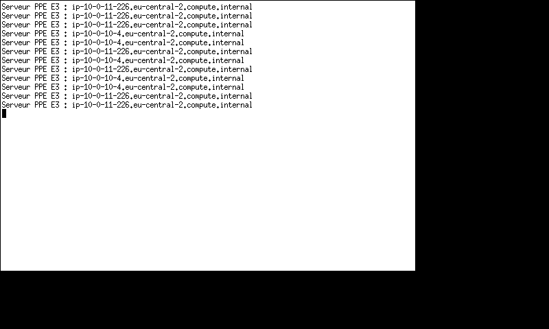
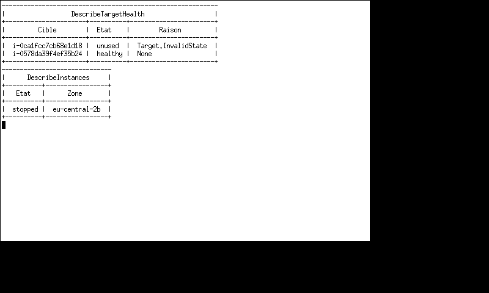
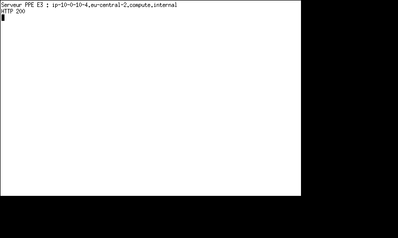
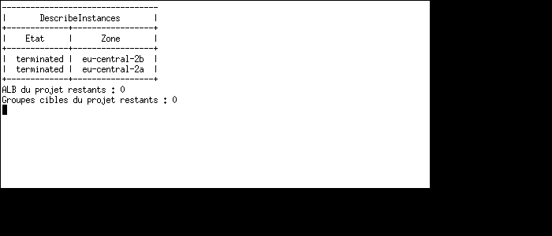

# Brique 3 — EC2 ×2 derrière un Application Load Balancer

Projet officiel couvert : projet 3 (serveur web sur EC2 derrière un répartiteur de charge).

## Résultat

Deux serveurs web **privés** (sans IP publique), un par zone de disponibilité, reçoivent le trafic
d'un **Application Load Balancer** placé dans les sous-réseaux publics. Les deux cibles passent le
contrôle de santé `/health`, la charge est répartie entre les deux zones, et le service continue de
répondre quand une instance est arrêtée.

## Architecture et choix

| Élément | Choix | Pourquoi |
|---|---|---|
| Serveurs | 2 instances Amazon Linux 2023 dans les sous-réseaux **applicatifs**, une par zone (`ppe-e3-b3-web-a`, `ppe-e3-b3-web-b`) | tolérer la perte d'une instance et d'une zone |
| Adresse publique | **aucune** (`IPv4Publique : None`) | les serveurs ne sont atteints que par l'ALB |
| Accès aux métadonnées | IMDSv2 obligatoire (prévu par le plan de déploiement ; pas visible dans les captures) | protège contre le vol d'identifiants par requête forgée côté serveur |
| Serveur web | `python3 -m http.server 8080`, lancé par un service systemd (utilisateur `nobody`, `NoNewPrivileges`) | aucun paquet à télécharger : le serveur démarre sans accès Internet. Script : [`userdata.sh`](userdata.sh) |
| Load balancer | ALB `ppe-e3-b3-alb`, dans les 2 sous-réseaux publics, écouteur **HTTP 80** vers le port **8080** | une entrée unique, réparti sur 2 zones |
| Groupe cible | `ppe-e3-b3-web`, HTTP 8080, contrôle de santé sur `/health` | n'envoie du trafic qu'aux serveurs sains |

Les 6 sous-réseaux et leurs tables de routage viennent de la [brique 2](../brique-2-vpc/README.md) :
rien n'est recréé.

## Groupes de sécurité chaînés

| Groupe | Entrée autorisée | Pourquoi |
|---|---|---|
| `ppe-e3-b3-alb` | TCP **80** depuis l'adresse IP du poste de test | l'ALB n'est pas ouvert à tout Internet pendant les tests |
| `ppe-e3-b3-app` | TCP **8080** depuis le **groupe de sécurité de l'ALB** uniquement | un serveur ne répond qu'à l'ALB, pas à une plage d'adresses |

Aucune règle SSH. La limitation du port 80 à l'IP du poste est indiquée par le compte rendu de la
réalisation : la capture ci-dessous montre le port, pas la source.

## Étapes

1. Vérifier les ressources de la brique 2 à Zurich et réutiliser les 2 sous-réseaux publics et les
   2 sous-réseaux applicatifs.
2. Créer les deux groupes de sécurité ci-dessus.
3. Lancer 2 instances Amazon Linux 2023, une par sous-réseau applicatif, sans IP publique, avec
   [`userdata.sh`](userdata.sh) comme script de démarrage.
4. Créer le groupe cible (HTTP 8080, contrôle `/health`) et y enregistrer les 2 instances.
5. Créer l'ALB dans les 2 sous-réseaux publics, avec un écouteur HTTP 80 qui transfère vers le
   groupe cible.
6. Attendre que les deux cibles soient saines, envoyer des requêtes, arrêter une instance et
   recommencer.
7. Supprimer l'ALB, le groupe cible, les instances et leurs groupes de sécurité.

Les commandes exactes de cette réalisation n'ont pas été enregistrées dans un script du dépôt :
seules les étapes et les preuves sont conservées.

## Tests et preuves

| # | Test | Résultat | Capture |
|---|---|---|---|
| T1 | sous-réseaux du VPC | 6 sous-réseaux disponibles, 2 zones | 01 |
| T2 | règle du groupe de l'ALB | TCP 80 | 02 |
| T3 | règle du groupe des serveurs | TCP 8080 depuis un groupe de sécurité | 03 |
| T4 | instances | 2 `running`, zones 2a et 2b, **aucune IP publique** | 04 |
| T5 | ALB et écouteur | `active`, 2 zones, `forward` HTTP 80 | 05 |
| T6 | santé des cibles | 2 cibles `healthy` sur le port 8080, contrôle `/health` | 06 |
| T7 | 12 requêtes vers l'ALB | **5 réponses de la zone A, 7 de la zone B** | 07 |
| T8 | arrêt de l'instance B | cible B `unused` (`Target.InvalidState`), cible A `healthy` | 08 |
| T9 | requête pendant que B est arrêtée | **HTTP 200**, servie par l'instance A | 09 |
| T10 | nettoyage | 2 instances `terminated`, 0 ALB, 0 groupe cible | 10 |

**Répartition de charge (T7).** Les 12 réponses portent le nom d'hôte du serveur qui a répondu, ce
qui prouve que les deux serveurs reçoivent du trafic :

**Perte d'une instance (T8 et T9).** Après l'arrêt de l'instance B, l'ALB ne lui envoie plus de
trafic (cible `unused`) et l'instance A continue de répondre :

## Limites de ces tests

- Les 12 requêtes forment **un échantillon** : la répartition 5/7 n'est pas un partage strict, c'est
  la preuve que les deux serveurs reçoivent du trafic.
- Le test de panne est **ponctuel** : après l'arrêt, la réponse HTTP 200 a été obtenue à la
  tentative suivante. **La durée d'une éventuelle interruption n'est pas mesurée.** La brique 5
  reprend ce test à l'échelle d'une zone, avec une mesure.
- L'ALB est limité à l'IP du poste de test : il n'est pas joignable depuis un autre poste.
- Le trafic est en **HTTP** (pas de HTTPS sur l'ALB) et le serveur Python est un serveur de
  démonstration, pas un serveur de production.

## Coûts et nettoyage

L'ALB et les instances sont facturés à l'heure même sans trafic : ils ont été supprimés après les
tests. AWS a confirmé la terminaison des 2 instances et l'absence de l'ALB et de son groupe cible ;
les deux groupes de sécurité dédiés ont aussi été supprimés (d'après le compte rendu).

## Problèmes rencontrés

- AWS a refusé le premier rattachement des instances au groupe cible parce que l'une d'elles
  démarrait encore : il faut attendre l'état `running`, puis recommencer.
- Une résolution DNS a expiré pendant un test ; la tentative suivante a reçu la page du serveur.
