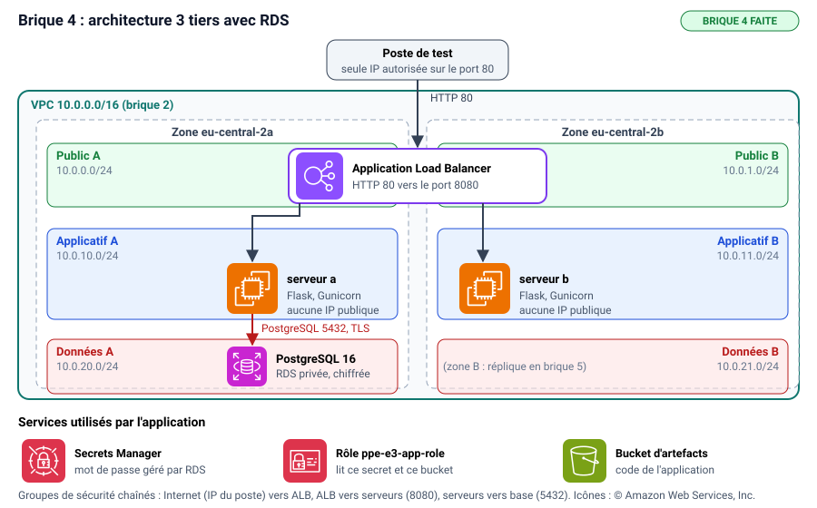
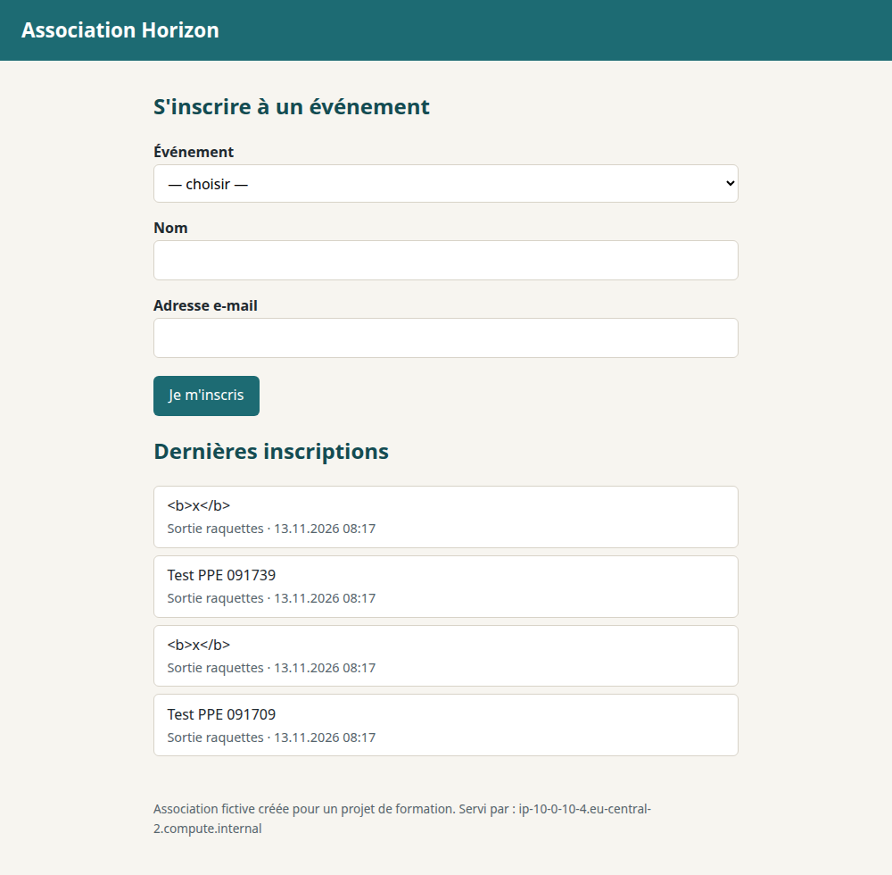
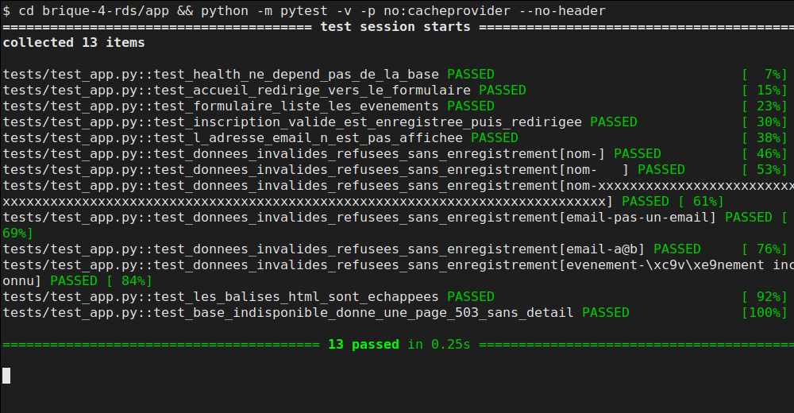
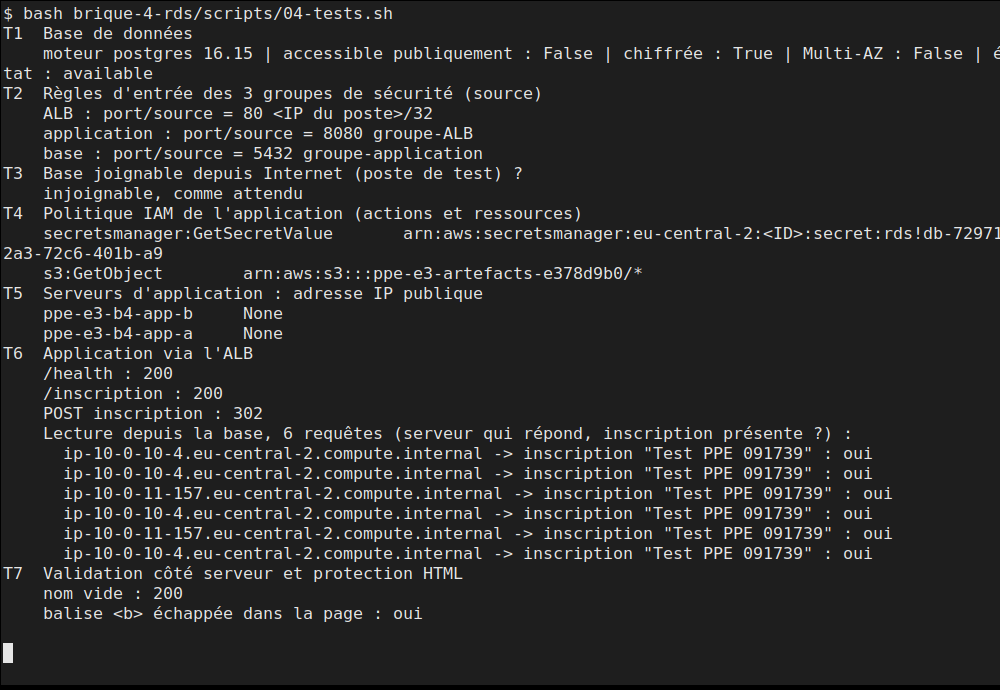
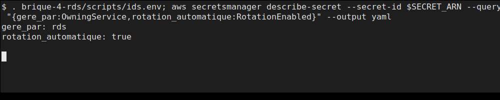

# Brique 4 — Architecture 3 tiers avec RDS

Projet officiel couvert : projet 4 (architecture 3 tiers avec base de données managée RDS).

## Résultat

Les trois niveaux sont en place et testés de bout en bout : un **Application Load Balancer**
(niveau web), deux **serveurs d'application** privés (niveau application) et une base **PostgreSQL
RDS** privée et chiffrée (niveau données). Une inscription saisie dans le formulaire est écrite en
base, puis relue par les deux serveurs.

## Architecture et choix

| Niveau | Choix | Pourquoi |
|---|---|---|
| Web | ALB `ppe-e3-b4-alb` dans les 2 sous-réseaux publics, HTTP 80 vers le port 8080 | entrée unique ; port 80 limité à l'adresse IP du poste de test |
| Application | 2 instances `t3.micro` Amazon Linux 2023, une par zone, sans IP publique, créées depuis un **modèle de lancement** (`ppe-e3-lt`) | le même modèle sert à l'Auto Scaling Group de la brique 5 |
| Données | RDS PostgreSQL 16.15, `db.t3.micro`, 20 Go gp3, dans les sous-réseaux « données », **non accessible publiquement, chiffrée**, une seule zone pour l'instant | la base n'a aucune route vers Internet |
| Mot de passe | **Secrets Manager**, géré par RDS (`--manage-master-user-password`), rotation automatique | jamais dans le code, dans un script ni dans le dépôt |
| Code | archive `app.tgz` dans un bucket S3 privé, installée au démarrage par [`userdata-app.sh.tpl`](scripts/userdata-app.sh.tpl) | pas de serveur à configurer à la main |
| Accès aux serveurs | Session Manager, aucune règle SSH | comme les briques précédentes |
| Sortie Internet des serveurs | NAT Gateway de la brique 2 (installation des paquets, API AWS) | les sous-réseaux applicatifs restent fermés en entrée |

### Groupes de sécurité chaînés

| Groupe | Entrée autorisée |
|---|---|
| `ppe-e3-b4-alb` | TCP 80 depuis l'adresse IP du poste de test |
| `ppe-e3-b4-app` | TCP 8080 depuis le **groupe de l'ALB** uniquement |
| `ppe-e3-b4-db` | TCP 5432 depuis le **groupe de l'application** uniquement |

### Droits de l'application (moindre privilège)

Le rôle `ppe-e3-app-role` n'a que deux permissions personnalisées, plus l'accès Session Manager :

| Action | Ressource |
|---|---|
| `secretsmanager:GetSecretValue` | **ce** secret uniquement (celui de la base) |
| `s3:GetObject` | le bucket d'artefacts uniquement |

L'application lit le secret avec le rôle de l'instance (aucune clé d'accès), le garde 5 minutes en
mémoire, et se connecte à la base avec `sslmode=require`.

## Application

Le code est dans [`app/`](app/) : Flask, Gunicorn, PostgreSQL.

- **Requêtes paramétrées** (pas d'injection SQL), **échappement HTML**, validation côté serveur.
- **L'adresse e-mail n'est jamais relue** pour l'affichage de la liste.
- **Page 503 générique** si la base est en panne, sans détail technique (il va dans les journaux).
- **`/health`** répond `ok` sans interroger la base : le load balancer juge le serveur, pas la base.
- **16 tests automatiques** (`pytest`) : validation, échappement, redirection, panne de base, et
  lecture des identifiants (variables d'environnement ou Secrets Manager simulé, avec cache).

## Réalisation

Scripts dans [`scripts/`](scripts/), à lancer dans l'ordre. Les identifiants créés sont écrits dans
`scripts/ids.env`, non versionné.

| Script | Rôle | Facturation |
|---|---|---|
| `01-securite-iam.sh` | 3 groupes de sécurité, bucket d'artefacts, rôle IAM | gratuit |
| `02-rds.sh` | groupe de sous-réseaux, RDS, politique IAM du rôle | **à l'heure** |
| `03-app-alb.sh` | NAT, modèle de lancement, 2 serveurs, groupe cible, ALB | **à l'heure** |
| `04-tests.sh` | tests des 3 niveaux | gratuit |
| `05-nettoyage.sh` | supprime tout ce qui est facturé à l'heure (briques 4 et 5) | libère |

## Tests et preuves

| # | Test | Résultat |
|---|---|---|
| T1 | la base | PostgreSQL 16.15, **non publique, chiffrée**, une seule zone, `available` |
| T2 | sources des règles d'entrée | ALB : IP du poste ; application : groupe de l'ALB ; base : groupe de l'application |
| T3 | port 5432 de la base depuis le poste de test (Internet) | **injoignable** |
| T4 | politique IAM de l'application | `GetSecretValue` sur un secret, `GetObject` sur un bucket |
| T5 | adresses IP publiques des 2 serveurs | **aucune** (`None`) |
| T6 | `/health`, `/inscription`, envoi du formulaire | **200**, **200**, **302** (redirection après enregistrement) |
| T6 | 6 lectures de la liste, réparties sur les 2 serveurs | l'inscription est **présente** à chaque fois, sur les deux serveurs |
| T7 | formulaire avec un nom vide | 200 avec message d'erreur, **rien d'enregistré** |
| T7 | nom `<b>x</b>` | affiché comme **texte** (balises échappées) |

Le secret de la base est bien géré par RDS, avec rotation automatique (la valeur du mot de passe
n'est jamais affichée) :

## Limites

- L'application se connecte avec l'utilisateur **administrateur** de la base ; un utilisateur
  dédié à droits réduits serait préférable en production.
- Le trafic de l'ALB est en **HTTP**, limité à l'IP du poste de test.
- Les heures affichées dans la liste sont en **UTC**.
- Le Docker du poste était arrêté : l'application n'a pas été essayée contre un PostgreSQL local,
  mais **directement contre RDS**, ce qui est le test qui compte.
- Les inscriptions de test restent dans la base jusqu'à sa suppression.

## Problèmes rencontrés

- **Descriptions de groupes de sécurité :** l'apostrophe est refusée par AWS.
- **Politique IAM « existe déjà » :** la CLI avait rejoué l'appel après un délai réseau ; la
  politique était bien créée. Le script est maintenant idempotent.
- **Capture de la page :** Chrome sans fenêtre refuse la page HTTP de l'ALB
  (`ERR_BLOCKED_BY_CLIENT`) ; la page a donc été récupérée par `curl` puis affichée localement.
- **Docker arrêté** sur le poste (le démarrer demande les droits administrateur).
