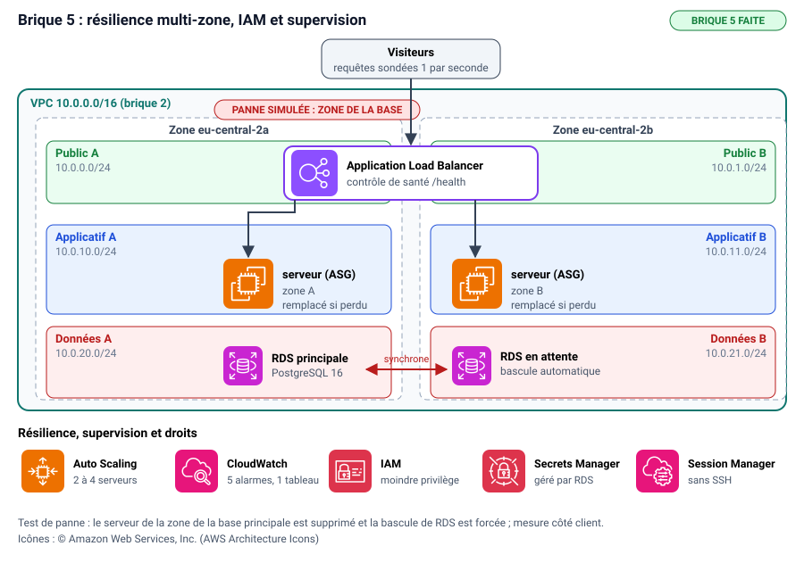
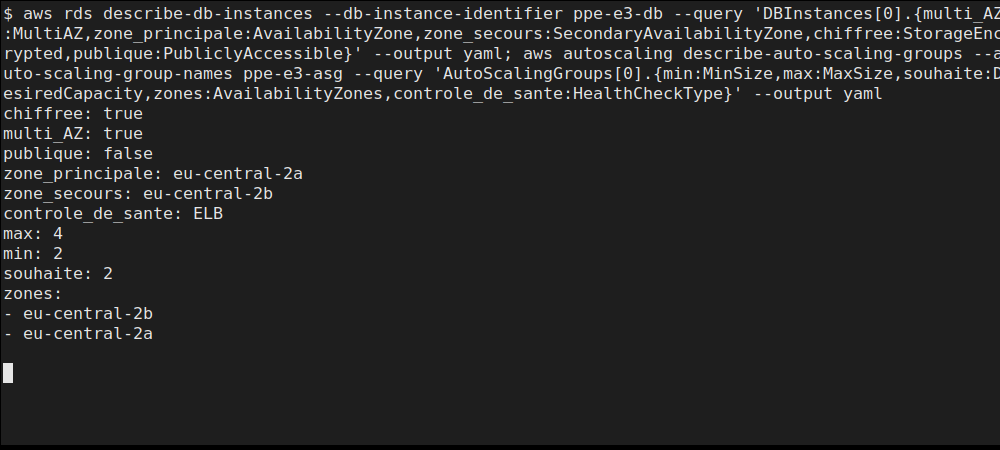
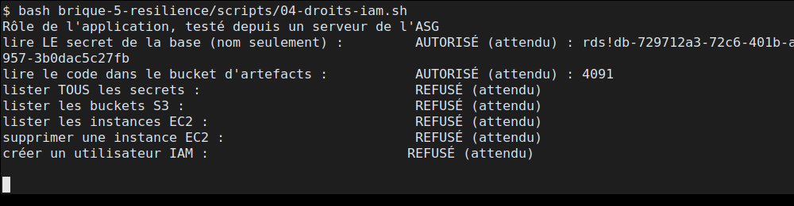
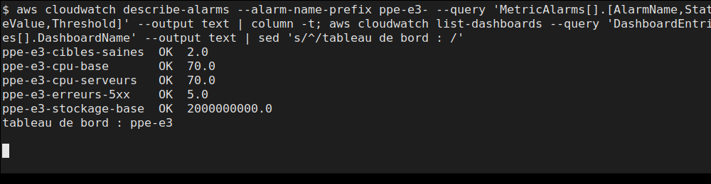
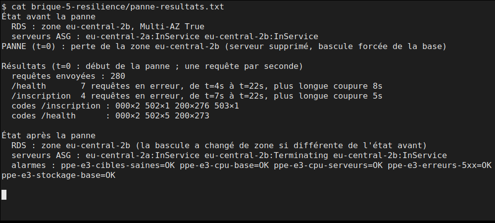
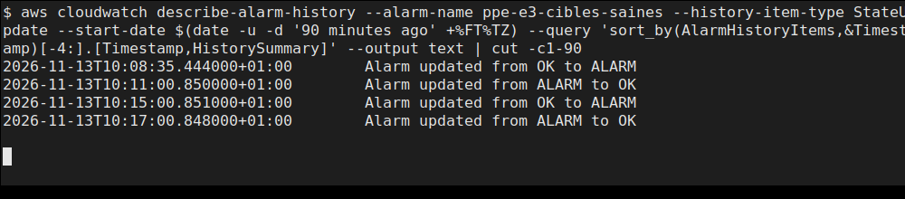
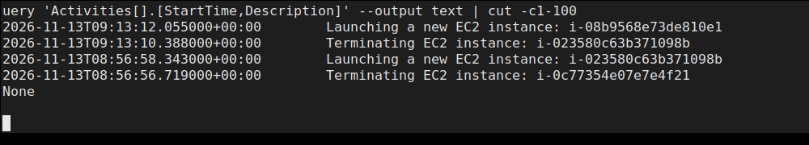

# Brique 5 — Résilience, IAM, supervision et coûts

Projet officiel couvert : projet 5 (architecture résiliente multi-AZ avec IAM et supervision).

## Résultat

L'architecture de la brique 4 est rendue **tolérante à la perte d'une zone** : base RDS en Multi-AZ,
serveurs dans un Auto Scaling Group sur 2 zones, rôle IAM au moindre privilège, 5 alarmes et un
tableau de bord CloudWatch. Une panne de zone a été simulée et **mesurée côté client** : l'interruption
dure de **5 à 21 secondes** selon l'essai, puis le service revient seul.

## Ce qui a été mis en place

| Élément | Réalisation |
|---|---|
| Base de données | `ppe-e3-db` passée en **Multi-AZ** : réplique synchrone dans l'autre zone, bascule automatique. Conversion en 7 minutes environ (de 08:22 à 08:29 UTC). |
| Serveurs | **Auto Scaling Group** `ppe-e3-asg` : 2 à 4 serveurs sur les 2 zones, **contrôle de santé de l'ALB** (un serveur que l'ALB juge malade est remplacé), même modèle de lancement que la brique 4, politique de mise à l'échelle sur le CPU (cible 60 %). Les 2 serveurs fixes de la brique 4 ont été retirés. |
| IAM | un seul rôle `ppe-e3-app-role` pour les serveurs : lire **un** secret, lire **un** bucket, plus Session Manager. Détail et preuve ci-dessous. |
| Supervision | **5 alarmes** CloudWatch, un sujet SNS et un **tableau de bord** `ppe-e3` (serveurs sains, requêtes et erreurs 5xx, CPU, connexions à la base, état des alarmes). |
| Coûts | estimation mensuelle chiffrée dans [`../couts/README.md`](../couts/README.md) |

## IAM : le moindre privilège, prouvé

Les commandes sont lancées **sur un serveur de l'Auto Scaling Group**, donc avec les droits de son rôle.
La valeur du mot de passe n'est jamais affichée (seul le nom du secret l'est).

| Action testée depuis un serveur | Résultat |
|---|---|
| lire **le** secret de la base | autorisé |
| lire le code dans le bucket d'artefacts | autorisé |
| lister **tous** les secrets | **refusé** |
| lister les buckets S3 | **refusé** |
| lister les instances EC2 | **refusé** |
| supprimer une instance EC2 | **refusé** |
| créer un utilisateur IAM | **refusé** |

Même l'utilisateur humain du projet est limité : il ne peut gérer que les rôles et politiques
nommés `ppe-e3-*` (voir la [brique 0](../brique-0-preparation/README.md)).

## Supervision

| Alarme | Condition | Pourquoi |
|---|---|---|
| `ppe-e3-cibles-saines` | moins de 2 serveurs sains (somme des 2 zones) | perte d'un serveur ou d'une zone |
| `ppe-e3-erreurs-5xx` | plus de 5 erreurs 5xx par minute sur l'ALB | les visiteurs voient des erreurs |
| `ppe-e3-cpu-serveurs` | CPU moyen des serveurs au-dessus de 70 % | saturation |
| `ppe-e3-cpu-base` | CPU de la base au-dessus de 70 % | saturation |
| `ppe-e3-stockage-base` | moins de 2 Go libres sur la base | disque presque plein |

Le sujet SNS `ppe-e3-alertes` est créé **sans abonnement e-mail** : une adresse doit y être ajoutée par
l'étudiant pour recevoir les alertes. Les alarmes passent donc bien à l'état `ALARM`, mais rien n'est
envoyé tant qu'aucun abonnement n'existe.

### Une alarme qui ne disait rien

Au premier essai, l'alarme `ppe-e3-cibles-saines` est restée **muette** pendant la panne. L'état
`OK` était trompeur : CloudWatch indiquait « aucune donnée reçue », et les données manquantes étaient
traitées comme « tout va bien ». Cause : une erreur de mon script, qui extrayait mal le nom du groupe
cible (`${TG#*:}` au lieu de `${TG##*:}`), donc une dimension fausse et aucune donnée correspondante.

Corrections : le nom est extrait correctement, l'alarme additionne les deux zones, et les données
manquantes y sont traitées comme une alarme (**`breaching`**) : une alarme muette est plus dangereuse
qu'une fausse alerte. Le test de panne a ensuite été refait pour vérifier que l'alarme se déclenche.

## Test de panne : perte de la zone de la base

**Scénario** ([`scripts/03-test-panne.sh`](scripts/03-test-panne.sh)) : on simule la perte de la zone qui
héberge la base principale, en **supprimant le serveur de cette zone** et en **forçant la bascule de
RDS**. Pendant ce temps, un client envoie **une requête par seconde** à deux pages :

- `/health` : ne dépend pas de la base ;
- `/inscription` : lit la base, donc subit la bascule.

### Mesures (t = 0 : début de la panne)

| | Essai 2 (alarme défaillante) | **Essai 3 (alarme corrigée, retenu)** |
|---|---|---|
| Requêtes envoyées | 274 | **280** |
| `/health` : requêtes en erreur | 6, de t=3 s à t=24 s | **7, de t=4 s à t=22 s** |
| `/health` : plus longue coupure | 5 s | **8 s** |
| `/inscription` : requêtes en erreur | 10, de t=4 s à t=31 s | **4, de t=7 s à t=22 s** |
| `/inscription` : plus longue coupure | 21 s | **5 s** |
| Codes `/inscription` | 000×3, 502×4, 200×264, 503×3 | **000×2, 502×1, 200×276, 503×1** |
| Codes `/health` | 000×3, 502×3, 200×268 | **000×2, 502×5, 200×273** |

Les codes `000` sont des délais dépassés (3 s), les `502` des erreurs de l'ALB quand il envoie une
requête à un serveur qui vient de disparaître, les `503` des réponses de l'application quand la base
est momentanément indisponible. Les données brutes de l'essai 3 sont dans
[`panne-sondes.txt`](panne-sondes.txt) (une ligne par seconde : heure, code de `/health`, code de
`/inscription`) et le résultat complet dans [`panne-resultats.txt`](panne-resultats.txt).

### Ce que le test montre

- **Le service reste disponible pour la quasi-totalité des requêtes** (273 sur 280 pour `/health`,
  276 sur 280 pour `/inscription`) : le serveur de l'autre zone répond pendant la panne.
- **L'interruption mesurée est courte** : de 5 à 21 secondes selon l'essai. Elle vient surtout du
  temps que met l'ALB à constater qu'un serveur ne répond plus (contrôles de santé toutes les 15 s,
  2 échecs consécutifs) et du temps de bascule de la base (AWS annonce 40 à 50 secondes entre le début
  et la fin de la bascule, dont une partie sans impact visible ici).
- **Le serveur supprimé est remplacé automatiquement, 2 secondes après sa disparition** (arrêt à
  09:13:10 UTC, nouveau serveur lancé à 09:13:12 UTC). Le remplaçant met environ 3 minutes et demie à
  être prêt (installation de l'application au démarrage).
- **L'alarme se déclenche puis se rétablit** : `OK` vers `ALARM` à 10:15:00, soit environ 1 min 50 s après
  le début de la panne (10:13:10), puis retour à `OK` à 10:17:00, quand le remplaçant est sain. Les deux
  premières lignes de l'historique (10:08 et 10:11) correspondent à la création de l'alarme, avant le test.

### Limites de ce test

- C'est une **simulation**, pas une vraie panne de zone AWS : on supprime un serveur et on force la
  bascule de la base. Le réseau de la zone reste, lui, en service.
- **Trois essais seulement**, un seul client, une requête par seconde, depuis un seul endroit : les durées
  varient d'un essai à l'autre (5 à 21 s) et ne sont pas des garanties.
- **Un seul serveur par zone** : pendant le remplacement, une zone n'a plus de serveur. Un minimum de 4
  serveurs (2 par zone) réduirait l'impact, pour un coût double.
- Le **NAT Gateway est unique** (zone A) : si sa zone tombait, les serveurs de l'autre zone perdraient
  leur sortie Internet (installation de paquets, API AWS), même si les requêtes des visiteurs
  continueraient d'être servies. Un NAT par zone supprimerait ce point unique.
- **Lecture de la zone de la base :** la ligne « RDS : zone … » affichée juste après le test est lue
  trop tôt et peut être périmée. La capture 02, prise plus tard, montre la base principale en zone A
  et la réplique en zone B : la bascule a bien eu lieu.
- L'alarme a été corrigée **en cours de route** ; l'essai 3 est le seul où elle fonctionnait.

## Coûts et nettoyage

Estimation mensuelle (118 USD environ, allumée en permanence) et trois pistes d'optimisation chiffrées :
[`../couts/README.md`](../couts/README.md).

Après les tests, tout ce qui est facturé à l'heure a été supprimé avec
[`../brique-4-rds/scripts/05-nettoyage.sh`](../brique-4-rds/scripts/05-nettoyage.sh) : ALB et groupe cible,
Auto Scaling Group, instances, base RDS (sans sauvegarde finale), NAT Gateway et adresse IP élastique.
Le script vérifie ensuite qu'il n'en reste rien.

Restent en place, car gratuits ou presque : le VPC et les sous-réseaux, le site S3 + CloudFront (qui doit
rester en ligne), les rôles IAM, le modèle de lancement, le bucket d'artefacts, les alarmes et le
tableau de bord.

## Réalisation

Scripts dans [`scripts/`](scripts/), après ceux de la brique 4 :

| Script | Rôle | Facturation |
|---|---|---|
| `01-multiaz-asg.sh` | RDS en Multi-AZ, Auto Scaling Group, retrait des serveurs fixes | **à l'heure** (le Multi-AZ double le coût de la base) |
| `02-supervision.sh` | sujet SNS, 5 alarmes, tableau de bord | quelques centimes par mois |
| `03-test-panne.sh` | simulation de la perte d'une zone et mesure côté client | gratuit |
| `04-droits-iam.sh` | preuve du moindre privilège depuis un serveur | gratuit |

## Problèmes rencontrés

- **Auto Scaling, rôle de service pas prêt :** au premier usage, AWS crée un rôle de service qui met
  quelques minutes à être utilisable ; la création de la politique de mise à l'échelle a échoué. Le
  script réessaie maintenant.
- **Test de panne interrompu au premier essai :** un délai dépassé de `curl` arrêtait ma boucle de
  mesure (`set -e`). La bascule de la base avait eu lieu, mais la mesure était perdue. Corrigé, puis
  trois essais ont été menés.
- **Alarme muette :** voir plus haut.
- **Fausse alerte dans mon propre test IAM :** le test « supprimer une instance » semblait autorisé
  parce que mon identifiant d'instance factice était mal formé et rejeté avant la vérification des
  droits. Corrigé en utilisant une vraie instance avec `--dry-run`.
